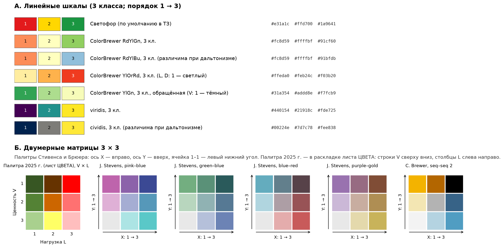
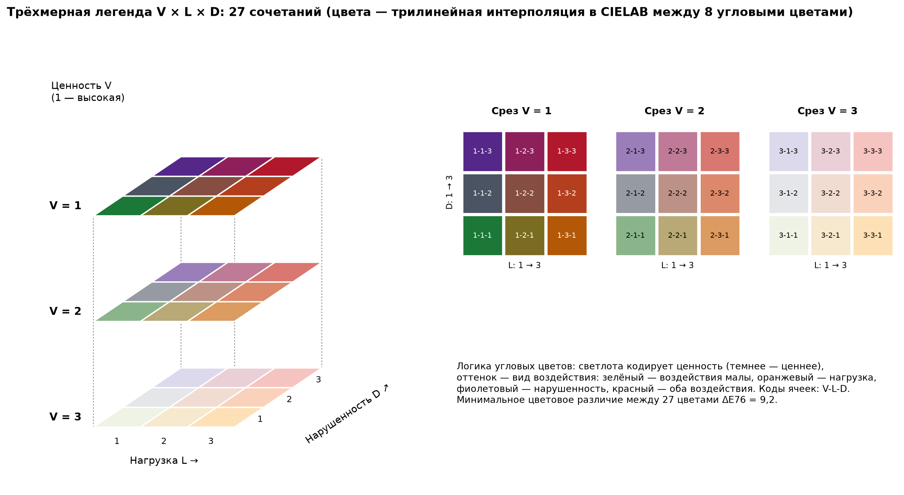

# Техническое задание на разработку программы расчёта баллов Ценности, Нагрузки и Нарушенности (V, L, D) на гексагональной сетке H3 и построения карт для ООПТ г. Москвы

| Параметр | Значение |
|---|---|
| Рабочее название программы | VLD‑H3 |
| Редакция ТЗ | 0.14 — учтены решения заказчика от 11.11.2026 по итогам этапа 2 (разд. 17.1, пп. 12–15): показатель редкости — только по сосудистым растениям, перенос QBS по ближайшей пробе той же ООПТ, слой экосистем для Кускова, Покровского‑Стрешнева и Царицына пока отсутствует, вопросы по насекомым отложены. Редакция 0.13 — уточнённая по результатам этапа 2 (`vld_h3.py` 0.2.0): подключены данные 2026 г. по летучим мышам, грызунам, низшим позвоночным трёх ООПТ и QBS 2025–2026 гг. (п. 6.4), введены контроль координат и выбор слоя GeoPackage (п. 6.5), окрестность выделов `D2` (п. 7.5), правило переноса QBS (п. 8.10), результаты испытаний П4, П7, П9 (разд. 15) и новые открытые вопросы (п. 17.2). Редакция 0.12 — согласованная к разработке (учтены решения заказчика и ответы исполнителя от 10–11.11.2026, многолетний архив по ООПТ и архитектурные упрощения от 11.11.2026, разд. 17.1: пакетный CLI + декларативный GUI поверх JSON‑схемы, внешние справочники CSV/XLSX, привязка полигонов и патчей к H3 по регулярной сетке 5–10 м, импорт 2025 г. через `V4` без эмуляции артефактов ArcMap на сырых точках, унифицированный вход для птиц/гидробионтов/QBS и два режима карт `V × L × D`) |
| Дата | 11.11.2026 |
| Организация | ИПЭЭ РАН, лаборатория биогеоценологии |
| Основа | расчёт 2025 г. («НОВЫЙ ПЕРЕСЧЕТ_V4.xlsx», слой V4.shp); проекты ArcGIS 10.8, слои и метаданные папок A2 и A3, в том числе полигоны экосистем 2025 г. (A2\DATA\POLY\lo_and_oozt_polys_classified_v29_10_2025.shp), растр CEPL_LC.tif, таблицы FRAGSTATS и книга скоринга насекомых (A3\насекомые_скоринг_антропоген_НОВ.xlsx); находки инвазивных и редких растений MODEL37\SP\invM37.shp и Rare_category.csv; блокнот и слои расчёта нагрузки («Рекреация по всем ООЗТ (нагрузка).ipynb», Nagruzka.zip); материалы расчёта насекомых 2026 г. (rating_2026.xlsx, координаты_2026.csv, nasek.zip); блокнот и слои расчёта фрагментации 2026 г. (Metriki_narushennost_Vektor.ipynb, Izm_Bittsa_bez_antropo.gpkg, dorozhki_vse_oozt.gpkg, patches_10m_rank.gpkg); данные 2026 г.: летучие мыши и грызуны (`letuchie-myshi.xlsx`, `gryzuny.xlsx`), низшие позвоночные Кускова, Покровского‑Стрешнева и Царицына (`Prilozhenie_Koordinaty_Nizsh_pozv_ORIG_2026_KLIMANOVOI_3_OOZT.xlsx`), QBS 2025–2026 гг. (`OOZT_QBS_2025-2026_01.xlsx`); логотипы; рукопись статьи (редакция v14); методика |

Состояние разделов:

| Блок | Состояние |
|---|---|
| Сетка H3, импорт данных, агрегация, квантование, многолетний архив по ООПТ, выгрузка, карты | требования определены |
| Ценность: млекопитающие, низшие позвоночные, редкие растения, ёмкость выдела, зональность | требования определены; требуют подтверждения размер единицы подсчёта ФГ млекопитающих, учёт планктофагов и пороги для низших позвоночных (разд. 17.2) |
| Ценность: насекомые | формат 2026 г., агрегация повторных площадок средним арифметическим, перевод `RATING` в балл 1–3 через min–max нормировку и проект соответствия биотопов 25 типам экосистем определены (п. 8.2, прил. Д); ожидаются пересчитанные значения `RATING` и согласование пограничных типов экосистем (разд. 17.2); воспроизведение V4 — 100 % (п. 3.4.8) |
| Ценность: птицы, фитопланктон, зоопланктон, зообентос | унифицированный импорт готового числа ФГ или готового балла 1–3 по точкам и водоёмам (п. 8.5, 8.6); детальные справочники ФГ и пороги подключаются по мере утверждения |
| Ценность: QBS почв | точки QBS 2025–2026 гг. по 15 ООПТ, пороги 250 и 350, перенос — ближайшая точка той же ООПТ последнего года не позднее года расчёта (п. 8.10); правило переноса утверждено 11.11.2026 (разд. 17.1) |
| Нагрузка | алгоритм по блокноту 2025 г. и входные форматы определены (разд. 9); воспроизведение V4 проверено (п. 3.4.6) |
| Фрагментация (в составе Нарушенности) | требования определены: 6 структурных классов, рассечение дорогами с твёрдым покрытием, `S_min = 0,1` га, знаки `ECON, ENN, SHAPE, CONTIG` и прямой перенос ячеек 10 м в H3 (п. 10.2); требуют подтверждения учёт/исключение `PARA` и веса водных границ (разд. 17.2) |
| Воспроизведение 2025 г. | 11 ООПТ 2025 г. воспроизводятся в 100 % гексагонов импортом `V4.xlsx` / `V4.shp` в архив `vld_archive.gpkg` и в наборе «2025 — исправленный»; разбор цепочек ArcMap 2025 г. сохранён в разд. 3 как методическая справка без переноса артефактов `Spatial Join` и `CreateFishnet` в расчётный код |

---

## 1. Назначение

1.1. Программа строит гексагональную сетку H3 по полигонам одной или нескольких ООПТ, рассчитывает для каждого гексагона частные показатели по табличным, векторным и растровым данным, агрегирует их в три балла — Ценность (V), Нагрузка (L), Нарушенность (D) — и сохраняет результат в векторный слой (GPKG или SHP). По результату строятся карты трёх типов: по одному параметру, по паре параметров (матрица 3 × 3) и по трём параметрам (27 сочетаний).

1.2. Программа должна:
- при параметрах по умолчанию (наборы 2025 г., разд. 14) давать результат, максимально близкий к «НОВЫЙ ПЕРЕСЧЕТ_V4.xlsx»;
- выполнять расчёт 2026 г. на новой типологии экосистем (вкладка «Изменённые по таксации»);
- хранить годичные результаты расчёта по каждой ООПТ и формировать сводные выгрузки и карты по сочетанию результатов разных лет (например, 11 ООПТ по расчёту 2025 г. и 3 ООПТ по расчёту 2026 г.);
- сохранять все параметры расчёта в файл, по которому расчёт повторяется с тем же результатом.

1.3. Работа ведётся через графический интерфейс; навыки программирования от пользователя не требуются.

## 2. Термины и обозначения

| Термин | Определение |
|---|---|
| ООПТ | особо охраняемая природная территория (в материалах 2025 г. и на картах — ООЗТ); полигон входного слоя с полем названия |
| Гексагон | ячейка H3 заданного разрешения. Для разрешения 11 средняя площадь ячейки по таблице H3 — 2 149,6 м², средняя длина ребра — 28,7 м [1]; на широте Москвы площадь ячейки ≈ 2 013 м², ребро ≈ 27,8 м |
| Частный показатель | балл 1–3 одного параметра (например, числа функциональных групп млекопитающих) |
| V_mean, D_mean | среднее частных показателей гексагона в блоке Ценности и Нарушенности |
| Квантование | перевод среднего (или исходного значения) в балл 1–3 |
| Домен квантования | множество гексагонов, по которому определяются пороги квантования |
| ФГ | функциональная группа видов |
| Единица учёта | точка, площадка, маршрут или водоём, к которому относится список видов |
| н/д | нет данных (NULL). Не равно 0; в среднее не входит |
| Ориентация шкалы | соответствие балла состоянию: по умолчанию 1 — лучшее (высокая ценность, низкая нагрузка, низкая нарушенность), 3 — худшее |
| Режим совместимости 2025 | воспроизведение результатов 2025 г. импортом `V4` в архив (п. 12.5.1); алгоритмы ArcMap 2025 г. описаны в разд. 3 как справка |

## 3. Расчёт 2025 г.: установленные правила

Раздел фиксирует, как получены значения V4; на этом основаны параметры по умолчанию. Проверка выполнена при подготовке ТЗ по файлу «НОВЫЙ ПЕРЕСЧЕТ_V4.xlsx», слою V4.shp, метаданным (lineage) слоёв папок A3 и A2 (в проектах 2025 г. — D:\DATA\IPEE\M\A2), книге скоринга насекомых A3\насекомые_скоринг_антропоген_НОВ.xlsx, блокноту «Рекреация по всем ООЗТ (нагрузка).ipynb» и пересчётом по исходным слоям A2, MODEL37\SP и архива Nagruzka.zip на всех 48 954 гексагонах. С редакции 0.12 раздел является методической справкой: результаты 2025 г. воспроизводятся в программе импортом `V4` (п. 12.5.1), а цепочки ArcMap 2025 г. (`Spatial Join` с правилами `First` / `Median` по соседям, `CreateFishnet` 250 м, IDW кода ФГ по сырым точкам) в код `vld_h3.py` не переносятся.

### 3.1. Состав и агрегация

3.1.1. Сетка: 48 954 гексагона H3 разрешения 11 в 11 ООПТ: Битцевский лес — 10 248; Воробьевы горы — 536; Долина реки Очаковки — 236; Долина реки Сетуни — 3 256; Измайлово — 7 685; Кузьминки‑Люблино — 4 873; Москворецкий — 15 209; Сокольники — 1 124; Теплый Стан — 1 554; Тропаревский — 1 076; Тушинский — 3 157.

3.1.2. V_mean — среднее арифметическое семи частных показателей (насекомые, млекопитающие, низшие позвоночные, редкие растения, ёмкость выдела, зональность, QBS) по имеющимся значениям; пропуски в среднее не входят (насекомые — 9 405 пропусков, млекопитающие — 416). Нулевые значения QBS (2 722 гексагона) вошли в среднее как число 0.

3.1.3. D_mean — среднее баллов инвазивных растений и фрагментации; где фрагментация отсутствует (3 178 гексагонов), D_mean равно баллу инвазивных растений.

3.1.4. L — прямые категории, без усреднения и квантования.

### 3.2. Квантование V и D

3.2.1. V и D получены терцилями по функции Excel PERCENTRANK.INC, вычисленной совместно по всем 48 954 гексагонам:

```
r(x) = N(x_j < x) / (n − 1)          — доля значений, меньших x
r*   = floor(1000 · r) / 1000        — усечение до трёх знаков (значимость по умолчанию [2])
балл = 1, если r* ≤ 0,33;  2, если 0,33 < r* ≤ 0,66;  3, если r* > 0,66
```

3.2.2. По этому правилу из V_mean и D_mean файла V4 баллы V и D воспроизводятся в 100 % гексагонов. Эквивалентные фиксированные пороги, дающие тот же результат (также 100 %):
- V: 1 — V_mean ≤ 2,0714; 2 — 2,0714 < V_mean ≤ 2,2262; 3 — V_mean > 2,2262 (фактически: класс 1 — средние до 2,000; класс 2 — 2,143–2,167; класс 3 — от 2,286);
- D: 1 — D_mean ≤ 1,25; 2 — 1,25 < D_mean ≤ 1,75; 3 — D_mean > 1,75 (D_mean принимает только значения 1; 1,5; 2; 2,5; 3).

3.2.3. Фактические доли классов: V — 40,3 / 30,9 / 28,8 % (19 746 / 15 112 / 14 096 гексагонов); D — 43,6 / 47,4 / 9,0 % (21 335 / 23 222 / 4 397); L — 74,3 / 23,4 / 2,2 % (36 394 / 11 465 / 1 095). Доли V и D отличаются от 1/3 из‑за совпадающих значений среднего. В рукописи статьи разбиение описано как деление на три равнонаполненные группы; для D это не выполняется. Обоснование терцилей в рукописи: при аддитивной агрегации высокие значения одних показателей компенсируются низкими значениями других, поэтому крайние значения интегрального балла редки [3]; распределение суммы баллов нескольких метрик близко к нормальному [4]. При делении на равные интервалы основная часть гексагонов попадает в средний класс.

### 3.3. Последовательность обработки в ArcGIS

По метаданным слоёв гексагональный слой собирался последовательными пространственными соединениями (Spatial Join; JOIN_ONE_TO_ONE, KEEP_ALL, INTERSECT) [5]: в папке A2 — с mammal3, an_pol и frag3; 12.11.2025 — с ec_val и recr (A3\VEC\hexMapclassReleveInsectMamAnFrag_Ecval_Recr); 13.11.2025 — с invM37 (A3\new_invas.shp). Ветка обработки в A2 с полями Disturb и VAL_DIS в V4 не вошла.

| Поле V4 | Источник | Правило объединения | Фактический результат |
|---|---|---|---|
| MAM | mammal3 — векторизованный растр mammalIdw3km_3class.tif: три многочастных полигона, по одному на класс (gridcode) | Median | медиана множества классов, которых касается гексагон |
| ANAM | an_pol — векторизованный растр anam_cl3.tif, устроен так же | Median | то же |
| FRAG | frag3 — векторизованный растр frag_3cl.tif, устроен так же | Median | то же |
| rare, major, zonal_eco | ec_val — гексагоны той же сетки в том же порядке (подготовлены в QGIS) | First | значение гексагона с наименьшим FID среди самого гексагона и касающихся его соседей |
| load_cat | recr — гексагоны той же сетки (QGIS), ключ h3_polyfil | Median | медиана по гексагону и шести соседям |
| inv_n | точки invM37 (MODEL37\SP\invM37.shp, 2 722 точки) | Count | число точек в гексагоне |
| INS_NEW | таблица INS_NEW.csv (из A3\насекомые_скоринг_антропоген_НОВ.xlsx по ключу TITLE × Map_Class; в CSV пропуски записаны нулём, в V4 — пусто) | соединение по FID | балл пары «ООПТ × биотоп» для класса Map_Class гексагона (п. 3.4.8) |

Правила в последнем столбце восстановлены по слоям A2: с ними все перечисленные поля V4 воспроизводятся в 100 % гексагонов. Существенны три обстоятельства.

1. Условие INTERSECT выполняется и при касании границ. Поэтому при соединении двух слоёв одной сетки гексагону сопоставляются он сам и до шести соседей. Поле Join_Count в V4 (1 — 30 гексагонов; 2 — 119; 3 — 468; 4 — 2 249; 5 — 3 470; 6 — 2 672; 7 — 39 946) совпадает с числом гексагонов, пересекающих данный.
2. First берёт первый из сопоставленных объектов во внутреннем порядке пространственного индекса, то есть не обязательно сам гексагон: для ec_val (та же сетка в том же порядке) — объект с наименьшим FID среди гексагона и его соседей (100 %), тогда как при более раннем переносе поля Map_Class из полигонов классификации `lo_and_oozt_polys_classified_v29_10_2025.shp` (88 766 выделов, слой `hex_MC1.shp`) — выдел с наибольшим `PolyID` среди пересекающих гексагон (100 %; с выделом наибольшей площади пересечения `Map_Class` в V4 совпадает лишь в 39,4 % гексагонов). Собственное значение гексагона в ec_val совпадает с V4 для редкости в 90,5 % гексагонов, ёмкости — в 96,0 %, зональности — в 97,1 %. Нагрузка V4 (медиана по семи гексагонам) совпадает с собственным значением recr в 86,2 % гексагонов.
3. Median вычисляется по сопоставленным объектам, а в mammal3, an_pol и frag3 каждый класс — один объект. Гексагон внутри одного класса получает этот класс; гексагон на границе классов — медиану множества классов, дробная медиана округляется к чётному (1,5 → 2; 2,5 → 2). В итоге при любом сочетании классов балл равен 2. Таких гексагонов: млекопитающие — 4 321 (8,8 %), низшие позвоночные — 1 290 (2,6 %), фрагментация — 8 888 (18,2 %). Округление к чётному подтверждается и нагрузкой: при округлении половин вверх совпадение L снижается до 99,8 %.

Растр invasive3.tif (переклассификация непрерывного растра invasive_clip.tif со значениями 0–0,939 по порогам 0,0555 и 0,2508) в D не входит: это вспомогательная модель распространения инвазивных видов.

### 3.4. Воспроизведение частных показателей по первичным данным

3.4.1. Млекопитающие. Цепочка 2025 г. (ArcMap 10.8, 08.11.2025): точки mammal_F.shp (A2\DATA\THERIA; совпадают с Mammal.csv: 2 990 находок, поле fun_group_ — код ФГ 1–6) → IDW по коду ФГ: ячейка 50 м, степень 1, фиксированный радиус 3 000 м без ограничения числа точек (mammalIdw3km.tif) → переклассификация [1; 2,573864] → 3; (2,573864; 3,335001] → 2; (3,335001; 6] → 1 (mammalIdw3km_3class.tif; доли ячеек классов 1 / 2 / 3 — 9,4 / 42,0 / 48,5 %) → векторизация (mammal3) → перенос на гексагоны по п. 3.3. Экстент растра — охват точек с полем в половину ячейки (25 м); из‑за четырёх точек с ошибочными координатами (п. 5.7) он составляет 38 089 × 31 524 ячейки. В ArcGIS по умолчанию степень IDW равна 2, а радиус переменный (12 ближайших точек) [6]; при фиксированном радиусе без минимального числа точек ячейки, в радиусе которых нет точек, остаются без значения (в V4 — 416 гексагонов без балла).

Собственная реализация IDW совпадает с mammalIdw3km_3class.tif в 98,9 % ячеек, с баллом V4 — в 98,2 % гексагонов (861 расхождение; 416 гексагонов без данных совпадают). Основной источник расхождений — совпадающие точки: 2 990 находок занимают 2 472 места, в 312 местах записей несколько (всего 830), и в 62 из них коды ФГ различаются. По документации ArcGIS точки с одинаковыми координатами и значениями считаются дубликатами и на результат не влияют; при разных значениях инструменты интерполяции могут брать первую или последнюю из них, поэтому такие точки рекомендуется удалять до расчёта [6]. Совпадение с растром 2025 г. (244 178 ячеек в охвате гексагонов с запасом 200 м): все точки без объединения — 95,0 %; первая из совпадающих — 98,7 %; последняя — 98,5 %; одна точка со средним или медианным кодом — 98,9 %. Остающиеся 2 736 расхождений (при среднем коде) не объяснены; у 52 % из них значение отличается от порога менее чем на 0,01, у 82 % — менее чем на 0,05.

Происхождение порогов в метаданных не указано. Это не равные интервалы (2,667 и 4,333) и не терцили; метод естественных интервалов (Jenks) на три класса по выборкам из 10 000 ячеек даёт близкий нижний порог (2,58 ± 0,01), но не верхний (3,68 ± 0,02). В режиме совместимости пороги задаются числами.

Растр подтверждает, что интерполировался код ФГ, а не число групп. Показатель отражает состав находок (64,5 % точек — код 2, «семенояд»), а не богатство ФГ, хотя в легенде карты 2025 г. он назван «Число функциональных групп млекопитающих».

3.4.2. Низшие позвоночные. Цепочка 2025 г.: точки Anamnia_point.shp (2 076 записей, из них 9 с координатами (0; 0); хищник — 1 820, всеядный — 241, планктофаг — 15) → сетка квадратов 250 × 250 м (CreateFishnet; начало координат 394 320,15; 6 154 237,54 в EPSG:32637) → для каждого квадрата с находками — число различных трофических групп (поле ORIG_FID слоя Anamnia_point2: одна группа — 672 квадрата, две — 64, три — 5; всего 741) → центроиды квадратов → IDW числа групп: ячейка 50 м, степень 1, фиксированный радиус 3 000 м (anam.tif) → переклассификация 1 → 3; (1; 2] → 2; (2; 3] → 1 (anam_cl3.tif) → векторизация (an_pol) → перенос на гексагоны по п. 3.3. Пересчёт из точек воспроизводит число групп во всех 741 квадрате, растр anam.tif — с точностью 1,2·10⁻⁷, классы растра и балл V4 — в 100 % ячеек и гексагонов.

Значение IDW равно 1 только там, где во всех квадратах с находками в радиусе 3 км по одной группе. Поэтому балл 3 означает, что в радиусе 3 км нет квадратов с двумя или тремя группами. Класс 1 занимает 342 ячейки растра за пределами гексагонов, поэтому в V4 балла 1 нет.

3.4.3. Интегральные баллы. Если все частные показатели взять из промежуточных слоёв A2 (mammal3, an_pol, frag3, ec_val, recr, invM37), насекомых — из книги `насекомые_скоринг_антропоген_НОВ.xlsx` (п. 3.4.8), а QBS — из V4, баллы V, L и D совпадают с V4 в 100 % гексагонов. При пересчёте всех доступных показателей из первичных данных — насекомых из таблицы нормированного скоринга и полигонов классификации (п. 3.4.8), млекопитающих из точек (п. 3.4.1), низших позвоночных из точек (п. 3.4.2), редкости из находок КК Москвы (п. 3.4.5), нагрузки из фотографий и рекреационных объектов (п. 3.4.6), инвазивных растений из точек (п. 3.4.4) и фрагментации из метрик FRAGSTATS (п. 3.4.7), с импортом `major` и `zonal_eco` из ec_val, а `QBS` из V4 — интегральный балл V совпадает с V4 в 98,9 % гексагонов (542 расхождения), L — в 99,6 % (172 расхождения), D — в 100 %.

3.4.4. Инвазивные растения: inv_n — число точек invM37 (2 722 точки; поля latitude, longitude, Species; EPSG:32637; в гексагоны попадают 2 005 точек) в гексагоне. Совпадение с V4 — 100 % (0 растений — 47 326 гексагонов; 1 — 1 364; 2 — 187; 3 — 53; 4 — 16; 5 — 6; 7 — 2). Балл в V4: 0 → 1; 1 → 2; ≥ 2 → 3.

3.4.5. Редкость, ёмкость, зональность.
- Редкость полностью воспроизводится из первичной таблицы `MODEL37\SP\Rare_category.csv` (6 181 находка в кодировке CP1251; поля `latitude`, `longitude`, `Species`, `Rare` — категория КК Москвы 1–5: кат. 1 — 251; 2 — 567; 3 — 4 475; 4 — 42; 5 — 846; в гексагоны попадают 4 746 находок в 3 312 гексагонах). В каждом гексагоне определяется наименьший номер категории (наивысший охранный статус): 1–2 → код 4; 3–4 → код 3; 5 → код 2; нет находок → код 1. Полученные коды совпадают с собственным полем `rare` слоя ec_val в 100 % гексагонов (389 / 2 490 / 433 / 45 642), а после переноса по правилу First (п. 3.3) — со столбцом M файла V4 также в 100 %. Следовательно, в 2025 г. редкость рассчитывалась напрямую по гексагону, а не через полигоны экосистем.
- Ёмкость (`major`: 0 — 34 257; 1 — 14 697) и зональность (`zonal_eco`; в ec_val также хранится составной код `value_clas = 100 · rare + 10 · major + zonal_eco`) подготовлены в QGIS 3.38 (слой ec_val / `ecosyst_value.gpkg`) и после правила First п. 3.3 совпадают с V4 в 100 % гексагонов, однако из полигонов классификации `lo_and_oozt_polys_classified_v29_10_2025.shp` (88 766 выделов, из них 290 площадью > 5 га) и пятен `frag.tif` не воспроизводятся: совпадение `major` с выделами > 5 га составляет 53–67 % в зависимости от правила переноса, с пятнами FRAGSTATS — менее 33 %; `zonal_eco` не является однозначной функцией `Map_Class`. Проектов QGIS по расчёту ec_val в папке M нет; в режиме совместимости `major` и `zonal_eco` импортируются из ec_val.

3.4.6. Нагрузка. Цепочка 2025 г. восстановлена по блокноту «Рекреация по всем ООЗТ (нагрузка).ipynb», входным слоям архива `Nagruzka.zip` и промежуточному слою `A2\VEC\recr_photo_category.gpkg` (он же `recr.shp`):
1. Фотографии ВКонтакте (`Фото на ООЗТ.gpkg`: 151 246 строк — объединение выборок по 20 и 11 ООПТ за 2022 г. и декабрь 2021 г.; 128 714 уникальных снимков по паре `id`, `owner_id`, из них 60 426 в гексагонах 2025 г.; в `recr` учтены 59 432 снимка): по числу снимков в гексагоне присваивается `photo_cat`: 0 → 1; 1 → 2; 2–3 → 3; 4–10 → 4; ≥ 11 → 5 (совпадение числа снимков с `recr` — 99,4 %, `photo_cat` — 99,5 %). В самом блокноте удаление дубликатов включало поле `NAME`, поэтому при разных значениях `NAME` межнаборные дубликаты сохранялись.
2. Рекреационные объекты (`Рекреационные объекты.gpkg`: после исключения записей `comment` ∈ {«Информационный стенд», «Урна»} и полных дубликатов — 2 848 / 2 862 точки шести функциональных групп рекреации, попадающие в 1 362 / 1 368 гексагонов 11 ООПТ): число объектов в гексагоне `sum_load` переводится в категорию `recr_cat`: 0 → 1; 1 → 2; 2–3 → 3; 4–5 → 4; ≥ 6 → 5. Сводная таблица `pivot_table` в блокноте содержала только гексагоны с объектами (`recr_cat` ≥ 2). В расчёте 2025 г. этот слой присоединили к сетке пространственным соединением по пересечению (с захватом шести соседей и правилом First, пустым — 1), поэтому `rect_infra` > 1 получили 6 177 гексагонов (совпадение с `recr.rect_infra` — 99,1 %). При более позднем запуске блокнота на 18 ООПТ (`Нагрузка_по_всем_ООЗТ.gpkg`, 80 954 гексагона) таблицы объединили по `h3_polyfill` с заменой пропусков нулём (`fillna(0)` вместо 1), что сместило 3‑балльную оценку в 6 942 гексагонах (8,6 %): 5 301 гексагон с одной фотографией и нулём объектов получил `sum = 2` и перешёл из класса 2 в класс 1, а 1 641 гексагон с `photo_cat = 5` и нулём объектов — из класса 3 в класс 2. Здания и дорожная сеть OSM используются в блокноте только для описательной типизации рекреации и в балл L не входят.
3. Сумма `sum = photo_cat + rect_infra` (значения 2–10) в `recr_photo_category.gpkg` переведена в 5‑балльную шкалу (2 → 1 — 34 757 гексагонов; 3 → 2 — 6 535; 4–5 → 3 — 5 717; 6–7 → 4 — 1 759; 8–10 → 5 — 186; те же числа приведены в выводе ячейки 55 блокнота), а при экспорте `recr.shp` объединением классов 2–3 → 2 и 4–5 → 3 сведена к 3‑балльной шкале `load_cat`: `sum = 2` → 1 (34 757); `3–5` → 2 (12 252); `6–10` → 3 (1 945; совпадение пересчёта из первичных точек с `recr.shp` — 99,6 %).
4. В ArcGIS балл L в V4 получен как медиана `load_cat` по гексагону и шести соседям с округлением половин к чётному (по `recr.shp` — 100 %; из первичных слоёв `Nagruzka.zip` — 99,65 %, 48 782 из 48 954 гексагонов). Сглаживание почти вдвое сократило класс 3: 1 095 гексагонов в V4 против 1 945 в `recr.shp` (класс 1 — 36 394 против 34 757). Без обоих соседских расширений (прямой подсчёт в самом гексагоне при `recr_cat = 1` для 0 объектов) доли классов 1 / 2 / 3 на данных 2025 г. составляют 75,8 / 21,7 / 2,5 % (37 093 / 10 636 / 1 225 гексагонов), отличие от L в V4 — 9 041 гексагон (18,5 %).

3.4.7. Фрагментация. Цепочка 2025 г.:
1. FRAGSTATS по растру CEPL_LC.tif (ячейка 10 м; классы forest — 1, grass — 2, scrub — 3, mire — 4, остальное — фон), правило восьми соседей (9 828 пятен; при правиле четырёх соседей их было бы 13 292). Веса контраста границ (econ1.fsq): лес — луг 0,6; лес — кустарник 0,4; лес — болото 0,8; луг — кустарник 0,2; луг — болото 0,6; кустарник — болото 0,8. Метрики пятен — SHAPE, CONTIG, ENN, ECON (файл 2.patch, затем patch.csv с округлением до двух знаков).
2. FRAG = 100 · [r(SHAPE) + r(CONTIG) + r(ECON) + r(−ENN)] / 4, где r — процентильный ранг: номер значения в упорядоченном ряду, делённый на 9 828, совпадающим значениям — средний номер. Формула воспроизводит frag.csv с точностью 5·10⁻⁸. Ранги считались по округлённым значениям: по метрикам 2.patch (четыре знака) расхождение достигает 0,75. FRAG тем выше, чем сложнее форма и выше связность пятна, контраст его границ и чем ближе соседнее пятно того же класса; значения пятен — от 8,0 до 95,1.
3. FRAG записан в таблицу атрибутов растра идентификаторов пятен frag.tif. Переклассификация: FRAG ≤ 0,9 → NoData (исключает фон, у которого FRAG = 0); (0,9; 75] → 3; (75; 85] → 2; (85; 100] → 1 (frag_3cl.tif; совпадение 100 % ячеек) → векторизация (frag3) → перенос на гексагоны по п. 3.3 (100 %).

Таблица «Расчет метрик фрагментации_upd.xlsx» (28.11.2025) составлена после V4 и отличается от frag.csv в среднем на 0,05.

4. Метрики FRAGSTATS воспроизводятся собственной реализацией на numpy/scipy по растрам `frag.tif` (идентификаторы 9 828 пятен) и `CEPL_LC.tif` (классы) во всех пятнах 2.patch: SHAPE и CONTIG — точно, ECON — с точностью 1·10⁻⁴, ENN — точно. Использованные определения FRAGSTATS для растра [16]: периметр — число сторон ячеек, граничащих с ячейкой другого пятна или фона, умноженное на размер ячейки; `SHAPE = P_ячеек / P_min`, где `P_min` — периметр наиболее компактной фигуры той же площади (`n = ⌊√a⌋`, `m = a − n²`; `P_min = 4n` при `m = 0`, `4n + 2` при `m ≤ n`, иначе `4n + 4`), так что `SHAPE ≥ 1`; `CONTIG = (Σc / a − 1) / (13 − 1)` по шаблону 3 × 3 с весом 1 для центральной ячейки, 2 — для ортогональных и 1 — для диагональных соседей того же пятна, `CONTIG ∈ [0; 1]`, у однопиксельного пятна — 0; `ECON = 100 · Σ (lᵢ · dᵢ) / P` — доля периметра, взвешенная коэффициентами контраста `dᵢ` из econ1.fsq (граница с фоном и краем растра в 2025 г. имела вес 0); `ENN` — евклидово расстояние между центрами ближайших граничных ячеек пятна и другого пятна того же класса (по правилу восьми соседей минимальное значение — 20 м). Расчёт по растру 3 583 × 3 100 занимает несколько секунд, поэтому FRAGSTATS для работы программы не требуется.

3.4.8. Насекомые. Цепочка 2025 г. для столбца `INS_NEW` файла V4 восстановлена по книге `A3\насекомые_скоринг_антропоген_НОВ.xlsx` (промежуточная таблица разворачивания на классы карты — `A3\насекомые_скоринг_антропоген_НОВ_пересчет.xlsx`; более ранний вариант поля `INS` слоя `hex.shp` — `A2\DATA\насекомые_скоринг_антропоген (1).xlsx`):
1. Лист `значения` содержит 55 строк — все сочетания 11 ООПТ × 5 укрупнённых энтомологических биотопов (`березняк`, `лиственный лес`, `луг`, `смешанный лес`, `сосняк`). Столбец `SCORE_NORM` линейно нормирован на отрезок `[0; 1]` (`min = 0`, `max = 1`); для необследованных в конкретной ООПТ биотопов подставлены импутированные средние с поправкой на уровень биотопа и территории (например, `0,735716` для сосняков Битцы, Измайлова и Тропарёва; `0,514530` для лиственного леса Кузьминок‑Люблина, Москворецкого, Тёплого Стана и Тропарёва).
2. Категориальный балл `SCORE_CAT` (1–3) получен делением отрезка `[0; 1]` на три равных интервала порогами `1/3` и `2/3`: `SCORE_NORM > 2/3 → 1` (24 пары); `1/3 < SCORE_NORM ≤ 2/3 → 2` (19 пар); `SCORE_NORM ≤ 1/3 → 3` (12 пар). Правило воспроизводит `SCORE_CAT` во всех 55 строках (100 %), равно как и в обеих сериях ранней книги `насекомые_скоринг_антропоген (1).xlsx`.
3. Лист `сопоставление_типов_экосистем` связывает 27 классов карты ЦЭПЛ (`Map_Class`) с пятью биотопами: `березняк` ← `Б, БД, БОс`; `лиственный лес` ← `БКл, БЛп, Д, Лп, ЛпД, ЛпКл, Ос, Ш`; `смешанный лес` ← `БЕ, БС, Е, ЕСШ, СШ`; `сосняк` ← `С`; `луг` (`суходольные+заливные луга`) ← `Grass` (`Травяная растительность`). Девять классов (`Ив, ИвКля, Олч, ПЛц, Сад, Scrub, Mire, Built, Water`) отнесены к группе `6 - серый` (`н/д`; в `INS_NEW.csv` записан `0`, при сборке V4 заменённый пропуском).
4. Соединение с гексагонами по паре `(TITLE, Map_Class)` (где `Map_Class` перенесён из `lo_and_oozt_polys_classified_v29_10_2025.shp` по правилу `First` — наибольший `PolyID`, п. 3.3) воспроизводит `INS_NEW` в 100 % гексагонов (48 954 из 48 954: балл 1 — 15 306 гексагонов, 31,3 %; 2 — 20 060, 41,0 %; 3 — 4 183, 8,5 %; `н/д` — 9 405, 19,2 %, покрытие 80,8 %). При определении `Map_Class` по наибольшей доле площади гексагона совпадение `INS_NEW` с V4 составляет 63,0 % (18 109 расхождений).

3.4.9. Из первичных данных 2025 г. не пересчитываются только QBS почв (приостановлен, импорт готовых баллов), а также ёмкость и зональность 2025 г. (импорт полей `major` и `zonal_eco` из ec_val, п. 3.4.5).

### 3.5. Расхождения и принятые решения

1. Пороги для млекопитающих в рукописи перекрываются: «4–6 групп — 1; 3–4 — 2; 1–2 — 3». Решение: 1–2 ФГ → 3; 3–4 → 2; 5 и более → 1 (разд. 17.1). К V4 эти пороги напрямую не применимы: в 2025 г. в баллы переводилась интерполированная поверхность кода ФГ (п. 3.4.1).
2. Зональность: в заголовке V4 «1 — самая ценная», в рукописи — «The factor “proximity to zonal ecosystems” was minimal (1 point) in the majority of cells (88.7%)» (в V4 балл 1 — у 43 401 из 48 954 гексагонов). Сходное место — о млекопитающих: «a predominantly medium-to-high level of functional diversity (59.3% of all hexagons scored 2 …, and 37.7% scored 3)»; при ориентации «1 — лучше» балл 3 означает низкий уровень. Ориентация подтверждена таблицей зональности 2026 г.: 1 — высокое соответствие зональному типу.
3. Инвазивные растения: правило V4 (1 растение → 2; ≥ 2 → 3) отличается от легенды (1–2 → 2; 3–7 → 3). Решение: правило легенды (разд. 17.1). По сравнению с V4 балл инвазивных меняется в 187 гексагонах (2 растения: 3 → 2), D — в 64 (0,13 %; везде 3 → 2).
4. QBS: 0 вошёл в среднее как число. Поскольку 0 меньше балла 1, он понижал V_mean, то есть повышал Ценность. Решение: 0 — н/д (разд. 17.1). По сравнению с V4 балл V меняется в 1 273 гексагонах (2,6 %): 1 → 2 — 678, 1 → 3 — 390, 2 → 3 — 205.
5. Рукопись, раздел о сетке: «approximately 2,000 m² (side length ≈ 278 m)» — сторона ячейки ≈ 28 м.
6. Правила соединения 2025 г. (п. 3.3, 3.4.6) дают эффекты, которых нет в методике: редкость, ёмкость и зональность гексагона берутся у соседа с наименьшим FID; в нагрузке категория рекреационных объектов распространяется на шесть соседей, а затем итоговая категория сглаживается медианой по семи гексагонам; гексагон на границе классов млекопитающих, низших позвоночных и фрагментации получает балл 2 независимо от долей классов. Предложение для 2026 г. (принято в ТЗ по умолчанию): собственное значение гексагона (для слоёв на той же сетке — соединение по `h3_id`, для нагрузки — подсчёт объектов и фотографий в самом гексагоне без расширения на соседей) и класс с наибольшей долей площади гексагона; правила 2025 г. сохраняются как режим совместимости (п. 7.5, 9.4). На данных 2025 г. собственные значения ec_val меняют V в 4 624 гексагонах (9,4 %); класс с наибольшей долей площади для млекопитающих и низших позвоночных — в 1 372 (2,8 %); собственное значение слоя recr меняет L в 6 774 гексагонах (13,8 %), а прямой подсчёт нагрузки без обоих соседских расширений — в 9 041 (18,5 %); класс с наибольшей долей площади для фрагментации меняет D в 5 675 (11,6 %). Все изменения на промежуточных слоях вместе меняют V в 5 688 гексагонах (11,6 %), L — в 6 774 (13,8 %; из первичных точек — в 9 041, 18,5 %), D — в 5 675 (11,6 %). Требуется подтверждение (разд. 17.2).
7. Насекомые: в рукописи статьи описан перевод непрерывного рейтинга `score = 9 − ln(1 + distance) · 8 / ln(1 + max_distance)` на шкале `[1; 9]` в 5‑балльную оценку `mark = min(5, int((9 − score) · 5 / 8) + 1)` с последующим нераскрытым сведением к 3‑балльной шкале, тогда как в расчётной книге 2025 г. (`насекомые_скоринг_антропоген_НОВ.xlsx`) категориальный балл `SCORE_CAT` получен из min–max нормированного `SCORE_NORM ∈ [0; 1]` равными интервалами `1/3` и `2/3` (п. 3.4.8). В материалах 2026 г. (`rating_2026.xlsx`) передан исходный рейтинг `RATING ∈ [1; 9]` по повторным площадкам шести биотопов (луг разделён на суходольный `dry` и низинный `wet`); в программе предусмотрены оба способа перевода в балл 1–3 и проект адаптации шести биотопов к 25 типам экосистем 2026 г. до получения комментариев исполнителя (п. 8.2, разд. 17.2, прил. Д).

## 4. Требования к среде выполнения

4.1. Операционные системы: Windows 10/11 и macOS 13 и новее (Intel и Apple Silicon). Работа в Linux желательна, но не обязательна.

4.2. Python 3.11–3.13. Зависимости:

| Назначение | Библиотеки |
|---|---|
| Векторные данные | geopandas ≥ 1.0, shapely ≥ 2.0, pyogrio, pyproj |
| Сетка | h3 ≥ 4.0; h3pandas 0.3 — для совместимости с примером `oozt.h3.polyfill_resample(11)` [7] |
| Расчёты | numpy, pandas, scipy (cKDTree для IDW и поиска ближайших границ патчей, ndimage для выделения связных патчей) |
| Растры | rasterio |
| Таблицы | openpyxl (XLSX), xlrd (XLS) |
| Карты | matplotlib, Pillow; contextily и xyzservices — подложки (необязательно) |
| Интерфейс | Tkinter/ttk (входит в Python); другой набор виджетов — по согласованию |

4.3. Программа поставляется одним автономным файлом `vld_h3.py` без отдельных локальных модулей Python; рядом размещается папка `resources` (логотипы, `defaults.json` со встроенными наборами параметров, палитрами и справочниками; при отсутствии `resources/defaults.json` используются резервные таблицы внутри `vld_h3.py`). Поддерживаются два режима запуска на единой JSON‑схеме параметров (`dataclass`): интерактивный запуск с графическим интерфейсом (`python vld_h3.py` без аргументов) и пакетный запуск из командной строки (`python vld_h3.py --config params.json`, а также ключи импорта в архив, выгрузки и построения карт) для автоматического тестирования и воспроизводимых расчётов. Сборка исполняемого файла (PyInstaller) — по отдельному решению.

4.4. Пути к файлам обрабатываются через `pathlib`; допускаются кириллица, пробелы, в том числе пробел в конце имени папки (пример: `…/практика /2026/`). Абсолютные пути в коде не допускаются.

4.5. Системы координат: метрические операции (расстояния, площади, IDW) — в EPSG:32637 (UTM 37N); выходной слой — EPSG:4326 (по умолчанию, как у H3) или EPSG:32637 / EPSG:3857 по выбору.

4.6. Производительность: полный расчёт для 50 000 гексагонов разрешения 11 без построения карт — не более 5 мин на ноутбуке (4 ядра, 16 ГБ ОЗУ); потребление памяти — не более 4 ГБ.

4.7. Код размещается в репозитории по выбору заказчика. Входные данные, в том числе координаты видов Красной книги, в репозиторий не включаются.

## 5. Требования к интерфейсу

5.1. Окно содержит: заголовок с логотипами; вкладки; нижнюю панель с индикатором выполнения, журналом и кнопками «Проверить данные», «Рассчитать», «Остановить», «Построить карты», «Открыть папку результатов».

5.2. Заголовок: четыре логотипа слева направо — ИПЭЭ РАН, лаборатория биогеоценологии, Правительство Москвы, ДПиООС; высота 48–64 пикселя с сохранением пропорций; название и версия программы. Логотипы загружаются из `resources/logos` (PNG с прозрачным фоном). Три файла переданы заказчиком (разд. 17.1): ИПЭЭ РАН (`ipee_ran.png`, из `Logotip.png`, 215 × 227 пикс.), лаборатория биогеоценологии (`lab_biogeocenology.png`, из `a89bfc99-3c18-449d-ad93-92ba97e090c8.jpg`, 640 × 640 пикс., с удалением внешнего белого фона вокруг круглой эмблемы), герб г. Москвы (`moscow_coat_of_arms.png`, из `57591391.png`, 575 × 728 пикс.); четвёртый файл (`dpioos.png`) подключается при передаче. При отсутствии файла выводится текстовое название организации. Использование символики организаций — по согласованию с ними.

5.3. Вкладки:

| № | Вкладка | Содержание |
|---|---|---|
| 1 | Проект и сетка | слой ООПТ, поле названия (автоподбор: NAME, TITLE, название), канонические идентификаторы ООПТ, выбор ООПТ (список с флажками: все / несколько / одна), год текущего расчёта `calc_year`, подключение архива годичных результатов (`vld_archive.gpkg`), разрешение H3, папка результатов, набор параметров |
| 2 | Ценность (V) | разделы по частным показателям |
| 3 | Нагрузка (L) | расчёт по слоям фотографий и рекреационных объектов или импорт готового слоя; пороги и сглаживание |
| 4 | Нарушенность (D) | инвазивные растения, фрагментация |
| 5 | Агрегация и квантование | способ агрегации и квантования отдельно для V, L, D; домен (включая учёт архивных ООПТ прошлых лет); ориентация шкалы |
| 6 | Выходные данные и архив | запись/импорт годичных результатов по ООПТ в архив; отбор срезов «ООПТ × год» (последний доступный / выбранный год / вручную по каждой ООПТ); формат выгрузки, состав полей, сводные таблицы |
| 7 | Карты | источник (текущий расчёт и/или архив годичных результатов с выбором года по ООПТ), типы карт, ООПТ, палитры, оформление |
| 8 | Проверка | сравнение с эталоном (V4) или межгодовое сопоставление двух срезов архива по одной и той же ООПТ |

5.4. Декларативное построение вкладок и сворачиваемые разделы. Элементы вкладок генерируются декларативно по схеме параметров (`dataclass`), что гарантирует полное совпадение параметров GUI и пакетного режима CLI. Каждый частный показатель оформляется сворачиваемым разделом с заголовком (стрелка ▸/▾ и флажок «учитывать») и краткой сводкой состояния; содержимое вкладки прокручивается. Табличные справочники (зональность, соответствие экосистем и `BIOTOP`, матрица контраста `6 × 6`, синонимы ООПТ, матрицы решений) хранятся в `resources/defaults.json` и заменяются или выгружаются пользователем через внешние файлы `CSV`/`XLSX` (с просмотром в окне без встроенного поклеточного редактора `Treeview`). Минимальный размер окна — 1024 × 700; при экране 1366 × 768 все элементы доступны прокруткой; масштабирование при 125–200 % (Windows) и Retina (macOS) не искажает разметку.

5.5. Выбор файлов — через системное окно (Проводник / Finder) с фильтрами типов и множественным выбором там, где допускается несколько файлов (например, несколько таблиц находок одной группы). Для GPKG — выбор слоя; для XLSX — выбор листа и строки заголовка; для CSV — автоопределение кодировки (UTF‑8, UTF‑8‑SIG, CP1251), разделителя (`,` `;` табуляция) и десятичного знака с предпросмотром первых 20 строк.

5.6. Сопоставление полей — выпадающие списки с автоподбором по именам: широта (lat, latitude, широта, Y, POINT_Y), долгота (lon, long, longitude, долгота, X, POINT_X), вид (вид, вид (латынь), species, taxon, таксон), ФГ (ФГ, fun_group, fun_group_num, Fgnum, FG), численность (численность, число особей, count, n), дата, идентификатор единицы учёта. Пользователь может исправить подбор.

5.7. Проверка данных до расчёта: наличие полей; система координат (при отсутствии .prj — запрос, по умолчанию EPSG:4326 для таблиц с координатами); допустимость координат (для Москвы по умолчанию широта 55,1–56,1, долгота 36,8–38,1; признак перестановки широты и долготы); удалённость от ООПТ (точки далее заданного расстояния, по умолчанию 10 км, исключаются с записью в отчёт; в Mammal.csv 4 точки удалены от района примерно на 2 400 км — по‑видимому, ошибка координат); исправление геометрий (`make_valid`); дубликаты; названия видов, не найденные в справочниках ФГ (список выгружается в CSV).

5.8. Наборы параметров: сохранение и загрузка в JSON; встроенные наборы (разд. 14). Каждый расчёт сохраняет свой набор параметров в папке результатов.

5.9. Длительные операции выполняются в фоновом потоке; окно остаётся отзывчивым; кнопка «Остановить» прерывает расчёт без порчи ранее записанных файлов. Журнал с отметками времени дублируется в файл.

5.10. Язык интерфейса — русский. У параметров — всплывающие подсказки (1–2 предложения) с определением и значением по умолчанию.

## 6. Входные данные

6.1. Перечень:

| № | Данные | Формат | Обязательные поля | Использование | Состояние |
|---|---|---|---|---|---|
| D1 | Границы ООПТ | полигоны SHP/GPKG | название | сетка, карты | обязательно |
| D2 | Экосистемы (типология 2026) | полигоны SHP/GPKG | код типа: 3‑значный (`110–503`) или 4‑значный геоморфологический (`1110–4400`, младшие три разряда `код % 1000`); необязательно — поправка зональности `zon_fix` (п. 8.9.4) | зональность, ёмкость, насекомые, фрагментация, водоёмы | обязательно для V и расчёта фрагментации 2026 г. из вектора |
| D3 | Соответствие «тип экосистемы → зональность» | XLSX/CSV | код или название типа, балл; (опц.) градация | зональность | для 2026 г. — файл типологии (п. 8.9.5); встроенная таблица (прил. Г) — при отсутствии столбца «Зональность» |
| D4 | Редкие сосудистые растения | точки SHP/GPKG или таблица с координатами | вид, категория КК Москвы | редкость | обязательно для V |
| D5 | Справочник категорий КК Москвы | XLSX/CSV | вид, категория | редкость (если в D4 нет категории) | при необходимости |
| D6 | Млекопитающие | точки / таблица; несколько файлов (2025 г.: `Mammal.csv`; 2026 г.: `letuchie-myshi.xlsx`, `gryzuny.xlsx`) | широта, долгота; вид или ФГ; (опц.) категория КК, единица учёта, дата | ФГ млекопитающих | обязательно для V |
| D7 | Низшие позвоночные | точки / таблица; несколько файлов (2025 г.: `Nizshie-pozvonochnye.xlsx`; 2026 г.: `Prilozhenie_Koordinaty_…_3_OOZT.xlsx`) | широта, долгота; вид (лат., рус.) или ФГ (хищник, планктофаг, всеядный); (опц.) категория ККМ, таксономическая группа | ФГ низших позвоночных | обязательно для V |
| D8 | Птицы | точки / таблица | точка учёта; вид и признаки (питание, тип гнездования, биотоп, ярус сбора корма) или готовое число ФГ | ФГ птиц | новое |
| D9 | Фитопланктон | таблица | ООПТ, водоём, проба, таксон, координаты | ФГ фитопланктона | новое |
| D10 | Зоопланктон, зообентос | таблица «таксон × водоём» | таксон, ФГ (1–5), водоёмы с координатами | ФГ зоопланктона и зообентоса | новое |
| D11 | Справочники «вид → ФГ» по группам | XLSX/CSV | вид (лат., рус.), ФГ | все ФГ | по группам |
| D12 | Насекомые | таблица рейтингов площадок XLSX/CSV (образец 2026 г.: `rating_2026.xlsx`) и (опц.) координаты площадок (`координаты_2026.csv`); либо таблица «ООПТ × биотоп → SCORE_NORM / балл»; либо готовые баллы по `h3_id` | `OOZT`, `BIOTOP`, `RATING` (опц. `MON`, `PLOT`) или `h3_id`, балл | насекомые (п. 8.2, прил. Д) | формат 2026 г. и алгоритм определены; ожидаются уточнения исполнителя (разд. 17.2) |
| D13 | QBS почв | таблица точек XLSX/CSV (`OOZT_QBS_2025-2026_01.xlsx`) или слой; по выбору — готовые баллы | широта, долгота, `QBSgm` (или балл), год; (опц.) ООПТ, биотоп | QBS (п. 8.10) | данные 2025–2026 гг. переданы |
| D14 | Инвазивные растения | точки / таблица | (опц.) вид, численность | инвазивные | обязательно для D |
| D15а | Нагрузка: фотографии с геотегами | точки GPKG/SHP или таблица с координатами | геометрия или широта/долгота; (опц.) `id`, `owner_id` для удаления дубликатов | составляющая `photo_cat` в L (разд. 9) | обязательно при расчёте L из первичных данных |
| D15б | Нагрузка: рекреационные объекты | точки и/или полигоны GPKG/SHP | геометрия; (опц.) поле типа / комментария (`comment`) для фильтрации нецелевых объектов | составляющая `infra_cat` в L (разд. 9) | обязательно при расчёте L из первичных данных; альтернатива D15а–D15б — готовый слой `h3_id → load_cat` |
| D16а | Фрагментация: дорожно‑тропиночная сеть | линии GPKG/SHP (образец: `dorozhki_vse_oozt.gpkg`) | геометрия; (опц.) `highway`, `is_paved`, `surface` для фильтрации | рассечение природных массивов и расчёт контраста границ `ECON` (п. 10.2) | обязательно при расчёте фрагментации 2026 г. из вектора |
| D16б | Фрагментация: здания | полигоны GPKG/SHP (`Здания на ООЗТ (категории).gpkg`) | геометрия | исключение застройки и расчёт `ECON` (п. 10.2) | обязательно при расчёте фрагментации 2026 г. из вектора (допускается пропуск при отсутствии зданий) |
| D16в | Фрагментация: готовый слой патчей или баллов | полигоны патчей GPKG/SHP (`patches_10m_rank.gpkg`), растр классов или таблица по `h3_id` | метрики / индекс патча или `h3_id`, `d_frag` | альтернатива расчёту по `D2`, `D16а`, `D16б` (п. 10.2.6) | необязательно |
| D17 | Эталон для сравнения | V4.xlsx / V4.shp / GPKG прежнего расчёта | h3_id, баллы | вкладка «Проверка» | необязательно |
| D18 | Водные объекты | полигоны | — | гидробионты, если в D2 нет водоёмов | необязательно |
| D19 | Логотипы | PNG / JPG | — | интерфейс, карты | три файла переданы (ИПЭЭ РАН, лаборатория биогеоценологии, герб Москвы); ДПиООС — при передаче |
| D20 | Слои 2025 г. (A2, A3, MODEL37\SP, Nagruzka.zip) | SHP, GPKG, TIF, CSV, XLSX | mammal3, an_pol, frag3 (gridcode); ec_val (rare, major, zonal_eco); recr (load_cat); invM37, Rare_category.csv; полигоны классификации 2025 г.; `CEPL_LC.tif`, `patch.csv` | методическая справка (разд. 3); по выбору — импорт отдельных готовых слоёв по `h3_id` или по моде площади (п. 7.5) | необязательно |
| D21 | Архив годичных результатов по ООПТ | GPKG (`vld_archive.gpkg`) | слои/таблицы `vld_yearly` и `runs_meta`: `oopt_id`, `oopt`, `calc_year`, `h3_id`, `V`, `L`, `D`, `V_mean`, `D_mean`, частные показатели (п. 12.5) | накопление результатов по ООПТ и годам, разнолетние выгрузки и карты, межгодовое сравнение | создаётся и пополняется программой; поддерживается прямой импорт `V4` за 2025 г. |

6.2. Названия видов сопоставляются со справочником после нормализации: удаление пробелов по краям, сведение повторных пробелов, регистр, ё → е, отбрасывание авторов таксона и пометок sp., cf., aff. Сначала сопоставляется латинское название, затем русское. Несопоставленные названия не прерывают расчёт и попадают в отчёт.

6.3. Если в данных о находках уже есть поле ФГ, справочник не нужен. Если вид относится к нескольким ФГ, по умолчанию учитываются все его группы (параметр).

6.4. Данные 2026 г. (переданы 11.11.2026):

| Файл | Содержание | Обработка |
|---|---|---|
| `letuchie-myshi.xlsx`, `gryzuny.xlsx` | 8 и 7 находок: широта, долгота, вид, категория КК, примечание | добавляются к `Mammal.csv` (D6); ФГ определяется по встроенному справочнику «вид → ФГ»: сопоставлены все 15 записей |
| `Prilozhenie_Koordinaty_Nizsh_pozv_ORIG_2026_KLIMANOVOI_3_OOZT.xlsx` | 324 находки рыб, земноводных и пресмыкающихся в Кускове, Покровском‑Стрешневе и Царицыне: номер наблюдения, ООЗТ, водный объект, дата, координаты, вид (рус., лат.), категория ККМ (2022), таксономическая группа; заголовок таблицы — в четвёртой строке | строка заголовка находится автоматически; поля ФГ нет, поэтому ФГ определяется по справочнику: по виду — 255 записей, по роду — 60; не сопоставлена уклея `Alburnus alburnus` (8 записей; разд. 17.2) |
| `OOZT_QBS_2025-2026_01.xlsx` | 118 проб по 15 ООПТ: парк, сезон, год, дата, координаты, биотоп, тип экосистемы, `QBSgm` и почвенные показатели; 2025 г. — 12 ООПТ, 2026 г. — Кусково, Покровское‑Стрешнево, Царицыно | п. 8.10 |

Названия парков в данных (`Битца`, `Царицино`, `Тропорево`, `ЛО` и др.) сводятся к `oopt_id` справочником синонимов (п. 12.5.1); синонимы из `resources/defaults.json` дополняют встроенные.

6.5. Контроль координат и выбор слоя:
- точки вне допустимого диапазона (по умолчанию широта 55,1–56,1°, долгота 36,8–38,1°) исключаются; если широта и долгота попадают в диапазоны друг друга, они переставляются; точки далее `far_km` от ближайшей ООПТ (по умолчанию 10 км) исключаются; точка относится к ООПТ, если лежит в её полигоне, расширенном на допуск (по умолчанию 100 м). Число переставленных, исключённых и повторяющихся записей по каждому файлу выводится в отчёт;
- слой многослойного GeoPackage задаётся записью `файл.gpkg::слой`; без указания слоя выбирается первый слой с подходящим типом геометрии, при нескольких — по имени (например, для рекреационных объектов — слой «Рекреационные объекты»). Выбранный слой записывается в отчёт;
- таблицы XLSX и CSV читаются с автоматическим поиском строки заголовка и подбором полей по списку синонимов (`широта`, `lat`, `decimalLatitude` и т. п.); при отсутствии обязательного поля выводится сообщение с перечнем найденных полей.

## 7. Гексагональная сетка

7.1. Сетка строится функцией H3 v4 `h3.geo_to_cells(polygon, res)`: в сетку входят ячейки, центры которых лежат внутри полигона ООПТ. Это эквивалент `polyfill_resample(res)` из h3pandas; на тестовом полигоне множества ячеек совпали полностью (h3 4.5.0, h3pandas 0.3.0). Ячейки не обрезаются по границе ООПТ (как в 2025 г.); режим «включать ячейки, пересекающие границу» — по выбору, по умолчанию выключен.

7.2. Разрешение — от 7 до 13, по умолчанию 11. В интерфейсе рядом с полем показываются средние площадь и длина ребра по таблице H3 и фактическая средняя площадь ячеек в районе расчёта:

| Разрешение | Средняя площадь [1] | Среднее ребро [1] |
|---|---|---|
| 9 | 105 332,5 м² (10,5 га) | 200,8 м |
| 10 | 15 047,5 м² (1,5 га) | 75,9 м |
| 11 | 2 149,6 м² | 28,7 м |
| 12 | 307,1 м² | 10,8 м |
| 13 | 43,9 м² | 4,1 м |

7.3. Несколько ООПТ: ячейка относится к ООПТ, в которую попадает её центр. Если центр попадает в две ООПТ (наложение полигонов), ячейка относится к ООПТ с большей площадью пересечения, а в журнал выводится предупреждение. Идентификатор ячейки в выходном слое уникален.

7.4. Атрибуты сетки: `h3_id` (текст), `oopt` (название), `area_m2` (площадь в EPSG:32637).

7.5. Связь гексагона с полигонами экосистем `D2` (зональность, ёмкость, насекомые, редкость по выделам) и с растровыми/полигональными слоями классов (решение от 11.11.2026):
- перенос площадных слоёв на гексагоны H3 выполняется без тяжёлого полигонального оверлея (`geopandas.overlay`) путём растеризации полигонов на регулярную метрическую сетку `5–10` м в EPSG:32637 и привязки центров ячеек растра к `h3_id` (`h3.latlng_to_cell`): для категориальных показателей гексагону присваивается выдел или класс с наибольшей долей числа ячеек внутри гексагона (мода площади; для зональности — балл с наибольшей суммарной долей площади), для непрерывных показателей (фрагментация п. 10.2.5) — среднее по ячейкам гексагона (при ненулевом пересечении мелких контуров без попадания центров 10‑метровых ячеек используется резервная выборка в центре гексагона);
- слой или таблица, уже построенные на сетке H3, присоединяются напрямую по ключу `h3_id`; артефакты `Spatial Join` ArcMap 2025 г. (сосед с наименьшим FID и медиана на границе классов, описанные в п. 3.3) в рабочий код 2026 г. не переносятся, а результаты 2025 г. воспроизводятся импортом эталона `V4` в архив (п. 12.5).

В выходной слой по выбору записываются `eco_code`, `eco_share` (доля площади), `n_eco` (число пересекающих полигонов).

Окрестность выделов `D2` (ред. 0.13): выделы, лежащие не далее заданного расстояния от ООПТ (по умолчанию 1 000 м), входят в окно расчёта данной ООПТ. Соседние пятна за границей учитываются в метриках фрагментации (`ENN`, `ECON`) и не обрываются на границе, а баллы получают только гексагоны сетки ООПТ. На слое `Izm_Bittsa_bez_antropo.gpkg` в окна Битцевского леса и Измайлова вошли 1 018 выделов (при допуске 100 м — 940); 3 выдела лежат дальше; гексагонов с типом экосистемы — 17 104.

7.6. Окрестность гексагона для прямого подсчёта задаётся числом колец H3 k: k = 0 — сам гексагон; k = 1 — 7 ячеек (≈ 1,4 га, радиус ≈ 70 м); k = 2 — 19 ячеек (≈ 3,8 га, ≈ 120 м); k = 3 — 37 ячеек (≈ 7,4 га, ≈ 170 м); k = 10 — 331 ячейка (≈ 67 га, ≈ 0,5 км); значения указаны для разрешения 11.

## 8. Блок «Ценность» (V)

### 8.1. Общие требования

8.1.1. Для каждого частного показателя задаются: флажок «учитывать», вес (по умолчанию 1), способ расчёта, пороги, правило для гексагонов без данных (н/д — не входит в среднее; или балл 3).

8.1.2. Результат частного показателя — балл 1–3 или н/д. В выходной слой по выбору записываются балл и исходное значение (например, число ФГ).

### 8.2. Насекомые

8.2.1. Входные данные (по материалам 2026 г. — архив `nasek.zip` — и расчёту 2025 г.):
- таблица рейтингов учётных площадок образца 2026 г. (`rating_2026.xlsx`, лист `rating`): поля `OOZT` (краткий код ООПТ: `KUS`, `STR`, `TSA` и др.), `MON` (месяц учёта, например `7`), `BIOTOP` (код энтомологического биотопа: `ber` — березняк, `dry` — суходольный луг, `lis` — широколиственный лес, `sme` — смешанный лес, `sos` — сосняк, `wet` — низинный луг), `PLOT` (номер повторной площадки: `1`, `2`), `RATING` — непрерывный интегральный показатель состояния энтомофауны на шкале `[1; 9]`, где большее значение отвечает меньшей дистанции от эталона и более высокой ценности (по предварительному срезу 36 площадок трёх ООПТ от 11.11.2026 значения составляют `1,661–8,458`; таблица считывается при каждом запуске без фиксации чисел в коде, поэтому подстановка пересчитанных `RATING` или расширенного перечня ООПТ не требует правки программы);
- необязательная таблица координат площадок (`координаты_2026.csv`, кодировка CP1251 или UTF‑8): поля `OOZT`, `OOZT_RUS`, `BIOTOP`, `BIOTOP_RUS`, `PLOT`, `Широта`, `Долгота` — используется для автоматического пополнения словаря кодов ООПТ и пространственной сверки площадок со слоями `D1` и `D2` (п. 8.2.5);
- альтернативные входы: таблица нормированного скоринга образца 2025 г. (`OOZT`, `BIOTOP`, `SCORE_NORM` и/или `SCORE_CAT`) либо таблица/слой готовых баллов по гексагонам (`h3_id` / `FID` → балл). Допускается одновременная загрузка нескольких таблиц рейтингов (например, объединение очередей обследования 2025 и 2026 гг.).

8.2.2. Сопоставление ООПТ и агрегация повторных площадок:
- коды и краткие названия `OOZT` (`KUS` → «Кусково», `STR` → «Покровское‑Стрешнево», `TSA` → «Царицыно», краткие обозначения 2025 г. `битца`, `вор.горы`, `кузьминки` и др.) сопоставляются с полем названия слоя границ `D1` по редактируемому справочнику и автоподбору по подстроке без учёта регистра, кавычек и категории ООПТ; при подаче координат площадок сопоставление дополнительно проверяется попаданием точек в полигоны `D1`;
- оценки `RATING` повторных площадок `PLOT` (и месяцев `MON`, если в таблице несколько туров учёта) внутри каждой пары `(ООПТ, BIOTOP)` сводятся к одной величине `R_ob` средним арифметическим (решение от 11.11.2026; по выбору в параметрах: медиана или максимум). В отчёт выводятся оценки отдельных площадок и разность `|R_1 − R_2|` с предупреждением при превышении порога (по умолчанию `2,0` единицы шкалы `1–9`; в предварительной выборке от 11.11.2026 порог превышен в парах `STR × dry`: `1,661` и `5,470`, разность `3,809`, и `KUS × ber`: `3,857` и `5,910`, разность `2,053`).

8.2.3. Перевод оценки пары «ООПТ × биотоп» в балл `v_ins ∈ {1, 2, 3}` (ориентация «1 — высокая ценность»; решение от 11.11.2026):
- способ А (по умолчанию для 2025 и 2026 гг.): линейная min–max нормировка `SCORE_NORM = (R_ob − R_min) / (R_max − R_min)` на отрезок `[0; 1]` по всем парам `(ООПТ, BIOTOP)` загруженных таблиц расчёта (при `R_max == R_min` расчёт останавливается с предупреждением) и деление на три равных интервала: `SCORE_NORM > 2/3 → 1`; `1/3 < SCORE_NORM ≤ 2/3 → 2`; `SCORE_NORM ≤ 1/3 → 3` (на книге `насекомые_скоринг_антропоген_НОВ.xlsx` воспроизводит `SCORE_CAT` во всех 55 строках, п. 3.4.8). В отчёт записываются фактические `R_min`, `R_max` и сводная таблица `(ООПТ, BIOTOP, R_ob, SCORE_NORM, v_ins)` (на предварительном срезе 18 пар `rating_2026.xlsx` от 11.11.2026: `R_min = 3,566`, `R_max = 8,386`, распределение баллов 1 / 2 / 3 — `1 / 10 / 7` до ожидаемого пересчёта `RATING`);
- способ Б (по выбору — абсолютная шкала `[1; 9]` по формуле рукописи): 5‑балльная оценка `mark = min(5, int((9 − R_ob) · 5 / 8) + 1)` со сведением к 3‑балльной шкале по редактируемому правилу (`1–2 → 1`, т. е. `R_ob > 5,8`; `3 → 2`, т. е. `4,2 < R_ob ≤ 5,8`; `4–5 → 3`, т. е. `R_ob ≤ 4,2`) либо прямые пороги `t1, t2` на `RATING`;
- способ В (по выбору): терцили по множеству пар `(ООПТ, BIOTOP)` или прямой импорт готового столбца `SCORE_CAT`.

8.2.4. Адаптация энтомологических биотопов к типологии экосистем 2026 г. и перенос на гексагоны:
- в 2026 г. единый луговой биотоп 2025 г. (`луг`) разделён на суходольный (`dry`) и низинный (`wet`), что соответствует разделению суходольных/мезофитных (`211, 212, 221`) и влажных (`231, 232`) травяных сообществ во вкладке «Изменённые по таксации»;
- связь 25 кодов экосистем `D2` (`110–503`) с шестью кодами `BIOTOP` (`lis`, `ber`, `sos`, `sme`, `dry`, `wet`) и категорией `н/д` задаётся редактируемой таблицей соответствия (по умолчанию — проект в прил. Д; при загрузке таблиц образца 2025 г. без разделения лугов оценка `луг` переносится на оба подтипа `dry` и `wet`);
- в расчёте 2026 г. гексагон получает балл через тип экосистемы `D2` с наибольшей долей площади гексагона (мода по ячейкам сетки 5–10 м, п. 7.5). Результат 2025 г. — импорт `v_ins` из `V4` (столбец J); расчёт по полигонам классификации 2025 г. с правилом `First` (п. 3.4.8) не реализуется.

8.2.5. Пространственная сверка площадок по координатам: при подаче файла `координаты_2026.csv` программа проверяет (1) попадание каждой площадки в полигон заявленной ООПТ слоя `D1` (все 36 площадок 2026 г. лежат строго внутри полигонов Кускова, Покровского‑Стрешнева и Царицына слоя `Границы ООЗТ.gpkg`) и (2) согласие между заявленным `BIOTOP` и типом экосистемы полигона `D2` в точке площадки (и в буфере 25 м) согласно таблице прил. Д. Несовпадения записываются в протокол проверки без автоматического переназначения `BIOTOP`.

8.2.6. Необследованные ООПТ и отсутствующие биотопы: если для ООПТ в целом (в `rating_2026.xlsx` представлены 3 из 18 ООПТ) или для отдельного биотопа внутри обследованной ООПТ оценка отсутствует, гексагоны получают `v_ins = н/д` и не входят в `n_V` при вычислении `V_mean` (п. 8.11). Импутация пропущенных биотопов внутри обследованных ООПТ средним по биотопу с поправкой на уровень территории (по образцу таблицы 2025 г.) выполняется только при явном включении пользователем соответствующего параметра.

### 8.3. Млекопитающие

8.3.1. ФГ (по справочнику 2025 г., по основному корму): 1 — «зеленояд»; 2 — «семенояд»; 3 — «веточные корма»; 4 — «беспозвоночные (наземные и подземные)»; 5 — «беспозвоночные в воздухе»; 6 — «позвоночные».

8.3.2. Способы расчёта:

| Способ | Описание | Параметры по умолчанию |
|---|---|---|
| А. Прямой подсчёт | число различных ФГ среди находок в гексагоне или его окрестности (п. 7.6) | k = 10 (≈ 67 га, по площади близко к ячейке H3 разрешения 8); нет находок → н/д |
| Б. IDW числа ФГ (2026) | (1) единицы учёта — по полю идентификатора или объединением находок в ячейки H3 более грубого разрешения; (2) число различных ФГ в каждой единице; (3) интерполяция в центры гексагонов | ячейки H3 разрешения 8 (≈ 0,69 км²); k = 12 ближайших единиц; степень 2; радиус не более 3 км; не менее 3 единиц, иначе н/д |
| В. Результат 2025 г. | импорт балла `v_mam` из `V4` (столбец K) в архив за 2025 г.; по выбору — импорт слоя `mammal3` (D20) с переносом по моде площади (п. 7.5). IDW кода ФГ по сырым точкам (п. 3.4.1) не реализуется | совпадение с V4 при импорте — 100 % |

8.3.3. Перевод числа ФГ в балл (способы А и Б; решение от 10.11.2026): 1–2 ФГ → 3; 3–4 → 2; 5 и более → 1. Интерполированное значение способа Б сравнивается с границами 2,5 и 4,5 без округления: < 2,5 → 3; 2,5–4,5 → 2; ≥ 4,5 → 1. Доступна также переклассификация терцилями в выбранном домене.

Число ФГ зависит от размера единицы учёта, поэтому пороги применимы только при заданной единице. Проверка на данных 2025 г. (Mammal.csv: 2 990 находок, 6 ФГ; способ Б, остальные параметры по п. 8.3.2; 48 954 гексагона):

| Единица учёта | Число единиц | Единицы с 1–2 / 3–4 / ≥ 5 ФГ, % | Гексагоны с баллом 1 / 2 / 3, % | Совпадение с баллом V4, % |
|---|---|---|---|---|
| ячейка H3 разрешения 9 (≈ 0,10 км²) | 660 | 86,2 / 13,2 / 0,6 | 0,1 / 7,0 / 92,5 | 41,6 |
| ячейка H3 разрешения 8 (≈ 0,69 км²) | 230 | 57,4 / 33,9 / 8,7 | 5,1 / 48,7 / 45,8 | 56,6 |
| ячейка H3 разрешения 7 (≈ 4,8 км²) | 71 | 35,2 / 36,6 / 28,2 | 43,5 / 41,3 / 11,3 | 31,6 |

Н/д — 0,4 % гексагонов при разрешениях 8 и 9, 3,9 % при разрешении 7. В V4 баллы 1 / 2 / 3 — 2,1 / 59,3 / 37,7 %; поскольку в V4 интерполировался код ФГ (п. 3.4.1), совпадение приведено для справки. При разрешении 9 показатель почти постоянен, поэтому по умолчанию принято разрешение 8, а для способа А — окрестность сопоставимой площади, k = 10 (баллы 1 / 2 / 3 — 11,8 / 39,9 / 34,4 %, н/д — 13,9 %). Если в V4 заменить балл млекопитающих баллом способа Б (разрешение 8), V меняется в 11 870 гексагонах (24,2 %).

8.3.4. Выбор между способами А и Б. Программа рассчитывает для каждой группы и каждой ООПТ: число находок и единиц учёта; коэффициент Спирмена между числом находок и числом ФГ в единице (на данных 2025 г. при разрешении 8 — 0,80); медианное расстояние до ближайшей соседней единицы; индекс Кларка — Эванса [8] (значения много меньше 1 указывают на скопления, например вдоль маршрутов); долю гексагонов, в окрестности которых есть находки. Рекомендация (правило редактируется): способ Б, если в ООПТ не менее 30 единиц учёта и медианное расстояние до соседней единицы не более половины радиуса интерполяции; иначе способ А. Решение принимает пользователь; рекомендация и показатели записываются в отчёт.

8.3.5. Диагностика IDW: перекрёстная проверка с исключением по одной единице (MAE, RMSE, доля верно предсказанных баллов); по выбору — слой расстояния до ближайшей единицы учёта как мера неопределённости.

### 8.4. Низшие позвоночные

8.4.1. ФГ: хищники, планктофаги, всеядные. В таблице от 26.09.2025 г. 2 068 находок с координатами (хищники — 1 813, всеядные — 240, планктофаги — 15; коды 1 / 2 / 3); в слое `Anamnia_point.shp` — 2 076 записей, из них 9 с нулевыми координатами, а кодировка поля `Field4` иная (1 — всеядные, 2 — планктофаги, 3 — хищники). Поскольку учитывается число различных групп, перестановка кодов на результат не влияет.

8.4.2. Способы А и Б — как в п. 8.3.2. Перевод целочисленного числа ФГ (способ А) в балл: 3 ФГ → 1; 2 → 2; 1 → 3; нет находок → н/д. Для интерполированного значения способа Б задаются редактируемые пороги:
- по умолчанию (пороги 2025 г.): `≤ 1` (с допуском `1 + 10⁻⁹`) → 3; `(1; 2]` → 2; `> 2` → 1; на данных 2025 г. при единицах H3 разрешения 8 (399 единиц: одна группа — 331, две — 63, три — 5) доли гексагонов с баллом 1 / 2 / 3 составляют 0,0 / 79,9 / 16,3 %, н/д — 3,8 % (в V4 — 0,0 / 82,6 / 17,4 %);
- по выбору — середины интервалов `1,5` и `2,5` (`< 1,5 → 3; 1,5–2,5 → 2; ≥ 2,5 → 1`); при тех же данных баллы 1 / 2 / 3 получают 0,0 / 11,6 / 84,6 % гексагонов, поскольку в 83,0 % единиц учёта отмечена только одна группа (хищники). Выбор порогов вынесен на согласование (разд. 17.2).

8.4.3. Результат 2025 г.: импорт балла `v_anam` из `V4` (столбец L) либо слоя `an_pol` (D20); цепочка `CreateFishnet` 250 м → IDW (п. 3.4.2) не реализуется.

8.4.4. Включение планктофагов (15 находок) — по решению заказчика (разд. 17.2).

8.4.5. Данные 2026 г. (п. 6.4) объединяются с таблицей 2025 г.: после контроля координат (п. 6.5; вне района — 12 записей, далее 10 км — 169) в пять ООПТ попадают 732 находки (Битцевский лес — 187, Покровское‑Стрешнево — 153, Царицыно — 152, Измайлово — 139, Кусково — 101). Рекомендация п. 8.3.4 по всем пяти ООПТ — способ А (6–26 единиц учёта при пороге 30). При способе А балл 3 получают 52 % гексагонов, балл 2 — 22 %, балл 1 — 2 %, н/д — 24 %; в Битцевском лесу и Измайлове совпадение с V4 — 16 и 15 % (в V4 преобладает балл 2, полученный интерполяцией кода ФГ, п. 3.4.2). Выбор способа — разд. 17.2.

### 8.5. Птицы (новое)

8.5.1. Имеющиеся данные двух видов: (а) для точек учёта в Битцевском лесу (2025 г.) уже рассчитано число ФГ (поле «функц.группы (всего 20)»), а также число видов и особей; (б) в учётной ведомости по Тёплому Стану для каждой регистрации вида указаны питание, тип гнездования, биотоп и ярус сбора корма. Программа поддерживает оба вида: импорт готового числа ФГ в единице учёта и расчёт числа ФГ, где ФГ — сочетание выбранных пользователем признаков (например, «питание × ярус сбора корма»). Состав признаков, образующих 20 групп, и справочник «вид → ФГ» не переданы (разд. 17).

8.5.2. Перенос на гексагоны — способы А и Б по п. 8.3.2; единица учёта — точка учёта. Пороги перевода числа ФГ в балл не определены; до решения — терцили в домене расчёта с выводом фактических порогов.

8.5.3. Унифицированный вход (ред. 0.12): до утверждения справочника «вид → ФГ» и состава 20 групп птицы подаются точками единиц учёта с готовым числом ФГ (`fg_n`) либо с готовым баллом 1–3 (`score`); перенос — способы А и Б п. 8.3.2, перевод числа ФГ в балл — по редактируемым порогам или терцилям. Конструктор ФГ из сочетаний признаков ведомости (питание × ярус и т. п.) в текущую версию не входит.

### 8.6. Гидробионты: фитопланктон, зоопланктон, зообентос (новое)

8.6.1. Единица учёта — водоём (или станция). Для водоёма рассчитывается число ФГ: для зоопланктона и зообентоса — по пяти группам по питанию (1 — хищники, 2 — собиратели, 3 — соскребатели, 4 — фильтраторы, 5 — разгрызатели); таблица по Битце имеет широкий формат: строки — таксоны с ФГ, столбцы — водоёмы, координаты в строке заголовка. Для фитопланктона в файле по Битце для каждого водоёма указан код ФГ 0, 1 или 2, смысл которого требует пояснения; таблица находок по ООПТ (ООПТ, водоём, проба, таксон, координаты) ФГ не содержит.

8.6.2. Перенос на гексагоны: гексагоны, пересекающие полигон водоёма (тип 400 в D2 или слой D18), и (опц.) береговая полоса шириной b (по умолчанию 0 м). Прочие гексагоны получают н/д и не включают этот показатель в V_mean.

8.6.3. Три показателя могут учитываться раздельно или объединяться в один показатель «Водные сообщества» (среднее или лучший из трёх баллов); объединение не даёт водным гексагонам трёх дополнительных слагаемых в среднем. Режим по умолчанию и пороги — по решению заказчика; предварительно для пяти групп: 4–5 → 1; 2–3 → 2; 0–1 → 3.

8.6.4. Унифицированный вход (ред. 0.12): для фитопланктона, зоопланктона и зообентоса подаётся одна таблица или слой «водоём (точка или полигон) → число ФГ или балл 1–3» с полем группы; разбор «широких» таблиц «таксон × водоём» в программу не входит (таблица приводится к длинному формату вне программы или в следующей версии). Перенос на гексагоны — по п. 8.6.2.

### 8.7. Редкие виды сосудистых растений

8.7.1. Правило 2025 г.: категории КК Москвы 1–2 → балл 1; категории 3–4, а также 5 и виды Приложения → 2; нет находок → 3. Правило задаётся редактируемой таблицей перекодировки.

8.7.2. Способы:
- по гексагону (по умолчанию 2026; фактическое правило расчёта `ec_val` в 2025 г., п. 3.4.5): наивысший охранный статус (наименьший номер категории) среди находок в гексагоне; по выбору — с буфером на неточность координат (0–30 м);
- результат 2025 г.: импорт балла `v_rare` из `V4` (столбец N);
- по выбору — по выделу: полигон экосистемы D2 получает лучшую категорию среди находок внутри него, гексагон — значение полигона по п. 7.5.

8.7.3. Отсутствие находок кодируется баллом 3, как в 2025 г. (параметр позволяет заменить на н/д).

8.7.4. Показатель строится только по сосудистым растениям (решение от 11.11.2026). Категории КК летучих мышей и грызунов и категории ККМ низших позвоночных из данных 2026 г. (п. 6.4) в показатель редкости не входят.

### 8.8. Ёмкость выдела

8.8.1. Пороги 2026 г.: S > 50 га → 1; 5 < S ≤ 50 га → 2; S ≤ 5 га → 3. Совместимость 2025: S > 5 га → 1; иначе → 3. Включение границ (≥ или >) настраивается.

8.8.2. Выдел — объект слоя экосистем D2. Балл ёмкости присваивается выделу по его площади (EPSG:32637) и затем переносится на гексагоны (п. 8.8.4). Смежные выделы не объединяются; составной (multipart) объект считается одним выделом.

8.8.3. В листе «Изменённые по таксации» таблицы типологии 2026 г. указано 900 полигонов выделов таксации Битцевского леса и Измайлова общей площадью 1 201,6 га; средняя площадь — 1,34 га. Отсюда следует, что не менее 73 % выделов имеют площадь ≤ 5 га и получат балл 3. В V4 балл 1 (выдел > 5 га) имели 14 700 гексагонов (30,0 %). Программа выводит распределение баллов ёмкости по выделам (число, площадь) и по гексагонам, по ООПТ.

8.8.4. По умолчанию (2026) гексагон получает балл выдела с наибольшей долей площади гексагона (мода по ячейкам сетки 5–10 м, п. 7.5). Результат 2025 г. — импорт `v_cap` из `V4` (столбец P).

### 8.9. Зональность

8.9.1. Показатель — соответствие экосистемы зональному типу: 1 — высокое; 2 — промежуточное или условное; 3 — низкое. Балл задаётся таблицей D3 «тип → балл»; для 2026 г. — столбцом «Зональность» вкладки «Изменённые по таксации» файла типологии (25 типов, прил. Г). Сопоставление с D2 — по коду типа, при его отсутствии — по названию (без учёта регистра и лишних пробелов). Подписи легенды частной карты — по столбцу «Градация» D3, при его отсутствии: 1 — «Высокое соответствие», 2 — «Промежуточный / условный», 3 — «Низкое соответствие».

8.9.2. Результат 2025 г.: импорт `v_zon` из `V4` (столбец R). В 2025 г. балл 1 имели 88,7 % гексагонов.

8.9.3. Тип D2, отсутствующий в D3, получает н/д (по умолчанию) или балл, заданный пользователем; программа выводит список таких типов с числом выделов и площадью.

8.9.4. Поправки по выделам. Примечания к таблице предусматривают пересмотр балла после уточнения состава: например, березово‑широколиственные — до 1 при подтверждённом доминировании широколиственных пород; травяные сообщества и высокотравье — до 3 при рудерализации. По типу эти случаи не различаются, поэтому в D2 допускается поле поправки (по умолчанию `zon_fix`, значения 1–3); заданное значение заменяет балл по типу. Программа выводит число и площадь выделов с поправками.

8.9.5. Источник баллов 2026 г. — файл типологии «!!!Экосистемы (с вкладкой Изменённые по таксации).xlsx», вкладка «Изменённые по таксации»: код типа — столбец «Индекс», следующий за столбцом «Тип» (в таблице три столбца «Индекс»: класса, подкласса и типа), балл — столбец «Зональность». Если столбца нет, используется встроенная таблица прил. Г. По сравнению с таблицей «Книга1_три_градации_зонального_соответствия.xlsx» в файле от 10.11.2026 балл 3 вместо 2 получили типы «Мелколиственные, старые сады» (131), «Черноольшатники» (132), «Ивовые» (134) и «Вода» (400).

### 8.10. QBS почв

8.10.1. Вход — точки проб с координатами, годом и значением `QBSgm` (D13) либо готовые баллы (таблица `h3_id → балл`, полигоны или точки). Перевод значения в балл (пороги редактируются): `QBS ≤ 250` → 3 (сильно нарушенные почвы); `250 < QBS ≤ 350` → 2; `QBS > 350` → 1. Значение 0 — н/д (вероятно, почва отсутствует; разд. 17.1). Учёт 0 как числа в среднем сохраняется только в наборах воспроизведения V4 («2025 — воспроизведение V4», «2025 — пересчёт из слоёв A2», п. 3.1.2).

8.10.2. Год пробы. Для каждой ООПТ используются пробы последнего года, не позднее года расчёта `calc_year`; при `calc_year = 2026` для Битцевского леса и Измайлова это 2025 г., для Кускова, Покровского‑Стрешнева и Царицына — 2026 г.

8.10.3. Перенос на гексагоны (параметр): по умолчанию — балл ближайшей пробы той же ООПТ (по выбору — с предельным расстоянием); по выбору — средний балл по ООПТ либо только гексагоны с пробами. На данных 2025–2026 гг. в пять ООПТ попадают 48 проб (7–13 на ООПТ); совпадение с V4 — 55 % (Битцевский лес) и 80 % (Измайлово). Правило по умолчанию — ближайшая проба той же ООПТ последнего года не позднее года расчёта — утверждено 11.11.2026 (разд. 17.1).

### 8.11. Агрегация V

V_mean — взвешенное среднее имеющихся частных показателей (н/д исключаются). Параметры: веса (по умолчанию 1); минимальное число показателей n_V,min (по умолчанию 1; при меньшем числе — н/д); по выбору — медиана вместо среднего. Программа выводит таблицу состава V по ООПТ: какие показатели доступны и в какой доле гексагонов. Таблица нужна прежде всего для новых показателей (птицы, гидробионты): они известны не для всех ООПТ, и их включение делает состав V разным в разных ООПТ.

## 9. Блок «Нагрузка» (L)

9.1. Алгоритм расчёта из первичных данных (по блокноту «Рекреация по всем ООЗТ (нагрузка).ipynb», встраивается непосредственно в `vld_h3.py`):
1. Фотографии с геотегами (D15а): при наличии полей идентификатора снимка и автора (`id`, `owner_id` — сопоставляются по п. 5.6) удаляются дубликаты по паре `(id, owner_id)` независимо от поля названия ООПТ; при отсутствии этих полей удаляются полные дубликаты координат и атрибутов. Для каждого гексагона подсчитывается число попавших точек `photo_n` и присваивается категория `photo_cat` по редактируемым порогам (по умолчанию: 0 → 1; 1 → 2; 2–3 → 3; 4–10 → 4; ≥ 11 → 5).
2. Рекреационные объекты (D15б — точки и/или полигоны; по выбору — дополнительный слой зданий рекреационного назначения): исключаются нецелевые записи по редактируемому списку значений поля комментария/типа (по умолчанию: «Информационный стенд», «Урна», «объекты нерекреационного назначения») и полные дубликаты. Для каждого гексагона подсчитывается число пересекающих объектов `infra_n` и присваивается категория `infra_cat` по редактируемым порогам (по умолчанию: 0 → 1; 1 → 2; 2–3 → 3; 4–5 → 4; ≥ 6 → 5). Гексагоны без объектов получают `infra_cat = 1`, а не 0 (п. 3.4.6).
3. Суммирование и шкалы: вычисляются `l_sum = photo_cat + infra_cat` (диапазон 2–10) и `l_raw = l_sum − 2` (число ступеней сверх минимума, 0–8). Формируются 5‑балльная категория `l_cat5` (2 → 1; 3 → 2; 4–5 → 3; 6–7 → 4; 8–10 → 5) и итоговый 3‑балльный показатель `L` объединением классов 2–3 → 2 и 4–5 → 3: `l_sum = 2` (`l_raw = 0`) → `L = 1`; `l_sum ∈ {3, 4, 5}` (`l_raw ∈ {1, 2, 3}`) → `L = 2`; `l_sum ∈ {6, …, 10}` (`l_raw ≥ 4`) → `L = 3`.
4. Пространственное сглаживание (параметр): по умолчанию (2026) выключено (`k = 0`, собственное значение гексагона); по выбору — медиана по окрестности `k` колец H3 с округлением половин к чётному.

9.2. Импорт готового слоя нагрузки: таблица или векторный слой с полем `h3_id` (`h3_polyfill`) и полем категории (`load_cat`, `l_cat`) или суммы (`sum`, `l_raw`). Если значения `load_cat` принадлежат шкале 1–5 (как в `recr_photo_category.gpkg` и `Нагрузка_по_всем_ООЗТ.gpkg`), программа переводит их в шкалу 1–3 по правилу 1 → 1; 2–3 → 2; 4–5 → 3. Если во входном слое обнаружены нулевые значения `recr_cat` при наличии поля `phptp_cat` / `photo_cat`, программа выводит предупреждение и предлагает пересчитать `l_sum` с подстановкой `recr_cat = 1` для гексагонов без объектов (п. 3.4.6).

9.3. Квантование L (п. 11): по умолчанию — прямые категории п. 9.1 (`l_raw`: 0 → 1; 1–3 → 2; ≥ 4 → 3). Доступны терцили, но при большой доле нулей они вырождаются: в V4 к классу 1 относились 74,3 % гексагонов (по прямому подсчёту — 75,8 %), поэтому все ненулевые значения получили бы ранг выше 0,66 и балл 3, а класс 2 остался бы пустым. При выборе терцилей программа выводит фактические доли и предупреждение.

9.4. Результат 2025 г.: импорт `L` из `V4` (столбец Y) либо готового слоя `recr` по `h3_id` (п. 9.2, по выбору с медианой по окрестности `k = 1`). Распространение `infra_cat` на соседей по правилу `First` (п. 3.4.6) не реализуется.

9.5. Дополнительная аналитика (из описательной части блокнота 2025 г., флажок, по умолчанию выключен): при подаче слоя дорожно‑тропиночной сети и (опц.) зданий рассчитываются плотность грунтовых дорожек и дорожек с твёрдым покрытием (м/га) и ведущий тип рекреации гексагона (в порядке убывания приоритета: массовый активный отдых, культурный досуг, отдых у воды, спортивный отдых и отдых с детьми, организованные пикниковые зоны, прогулочный отдых, не определён). В расчёт балла L эти показатели не входят.

## 10. Блок «Нарушенность» (D)

### 10.1. Инвазивные растения

10.1.1. Значение (параметр): число растений в гексагоне — число точек (одна точка — одно растение; по умолчанию, как в 2025 г.; на слое `invM37.shp` совпадает со столбцом Z V4 в 100 % гексагонов) или сумма поля численности, если оно задано; по выбору — число видов.

10.1.2. Перевод в балл (параметр):

| Правило | 0 растений | 1 | 2 | ≥ 3 |
|---|---|---|---|---|
| Основное (по умолчанию; легенда карт 2025 г., разд. 17.1) | 1 | 2 | 2 | 3 |
| Совместимость V4 | 1 | 2 | 3 | 3 |

В 2025 г. максимум — 7 растений в гексагоне. Основное правило по сравнению с V4 меняет балл инвазивных в 187 гексагонах и D — в 64 (0,13 %). Правило «совместимость V4» используется только в наборах воспроизведения V4 (разд. 14). Растр вероятности по модели MaxEnt в расчёт D не входит.

### 10.2. Фрагментация

10.2.1. Основа алгоритма 2026 г. и устраняемые дефекты прототипа. Расчёт по блокноту `Metriki_narushennost_Vektor.ipynb` (на растре 10 м в EPSG:32637 по вектору экосистем `D2`, дорожно‑тропиночной сети `D16а` и зданиям `D16б`) встраивается непосредственно в `vld_h3.py` без вызова внешних программ. При проверке прототипа и выходного слоя `patches_10m_rank.gpkg` (3 717 патчей по Битцевскому лесу и Измайлову) выявлены шесть расчётных дефектов, которые в штатном режиме `vld_h3.py` устраняются:
1. Перенос через центроиды патчей (ячейка 4 блокнота): приписывание патча единственному гексагону H3, куда попал его центроид, оставляет без оценки основную площадь крупных массивов (до 110 га): в границах Битцевского леса и Измайлова (18 681 гексагон) центроиды попали в 3 211 гексагонов (17,2 %), тогда как полигоны патчей пересекают 17 278 гексагонов (92,5 %); при этом сетка строилась по прямоугольному охвату растра (276 907 ячеек) с заменой пустых значений нулём (`fillna(0)`) до ранжирования метрик.
2. Растеризация линейных дорожек без буфера с `all_touched=False`: линия нулевой ширины прожигает ячейку 10 × 10 м только при прохождении через её центр, что даёт диагональные разрывы маски дорог (слияние соседних кварталов) и отсекает угловые одиночные ячейки (819 из 3 717 патчей — 22,0 % площадью 0,01 га; ≤ 0,05 га — 38,2 %).
3. Подсчёт периметра числом граничных ячеек вместо числа внешних сторон ячеек: у однопиксельного патча 10 × 10 м (100 м², истинный периметр 40 м) периметр занижался до 10 м, вследствие чего у 2 987 из 3 717 патчей (80,4 %) получено `SHAPE < 1` (минимум 0,25), а у 1 684 патчей (45,3 %) `PARA` упёрся в потолок 0,100.
4. Пропуск веса центральной ячейки (`+1`) в окне 3 × 3 индекса смежности `CONTIG`: у всех 819 однопиксельных патчей получено `CONTIG = −0,083` вместо `0,000`.
5. Расчёт `ENN_m` между центроидами патчей вместо расстояния между их границами: крупнейшие лесные массивы (15–35 га), разделённые 10‑метровой просекой (истинное расстояние между краями 10–20 м), получили `ENN_m = 195–234` м и худший балл 3, тогда как смежные однопиксельные осколки на перекрёстках (`14,1` м между центрами) получили балл 1.
6. Разрыв совпадающих значений `rank(method="first")` по номеру патча (нумерация растра с севера на юг) и обращённый знак `ECON`: среди 3 169 патчей (85,3 %) с одинаковым `ECON = 1,000` северная ООПТ (Измайлово) получила 0 патчей с баллом 1 и 737 с баллом 3, а южная (Битцевский лес) — 1 189 с баллом 1 и 0 с баллом 3 (средний `ECON_score` — 2,72 против 1,60; обратный сдвиг по `PARA == 0,100` — 1,73 против 2,15); при этом `direction["ECON"] = +1` присваивал лучший балл 1 патчам, полностью окружённым дорогами и застройкой, и худший балл 3 — внутренним массивам без техногенных границ (`patch_id = 1`, `ECON = 0,051`).

10.2.2. Подготовка растра по шести структурным классам (размер ячейки `s` — по умолчанию 10 м, выравнивание экстента кратно `s` в EPSG:32637; решение от 11.11.2026):
- полигоны слоя экосистем `D2` (поддерживаются как 3‑значные коды `110–504`, так и 4‑значные геоморфологические коды `1110–4504` по младшим трём разрядам `код % 1000`) сводятся по редактируемой таблице к шести структурным классам книги «!!!Экосистемы (с вкладкой Изменённые по таксации).xlsx» (листы `Лист1`, `Изменённые`, `ЗарастающиеЛуга`, `Изменённые по таксации`):
  - `1 — лес` (класс `10` «Лесные, преимущественно закрытые насаждения», все коды `110–171`);
  - `2 — луг` (класс `20` «Травяные, преимущественно открытые», подклассы `21–23`: коды `211–223, 231–233`);
  - `3 — кустарник` (зарастающие древесно‑кустарниковой растительностью луга / аналог ЦЭПЛ `Scrub`: коды `224, 241`);
  - `4 — болота` (класс `30` «Болота»: коды `301, 302, 310`);
  - `5 — вода` (класс `40` «Водные объекты»: коды `400, 401–414`);
  - `6 — антропоген` (класс `50` «Антропогенные»: коды `501–504` — застройка, асфальт, дачи, газоны, стройплощадки). Предварительно удалять антропогенные полигоны из `D2` не требуется; если подан слой без антропогенных выделов, класс `6` формируется дорогами, зданиями и внешней городской границей;
- из слоя дорожно‑тропиночной сети `D16а` исключаются строящиеся и проектируемые линии (`highway ∈ {proposed, construction}`) и по умолчанию отбираются только дороги и дорожки с твёрдым покрытием (`is_paved = 1`; режим «все дорожки» и ширина буфера сохраняются как параметры). Отобранные линии растеризуются с `all_touched=True` поверх растра экосистем в класс `6 — антропоген`; полигоны зданий `D16б` также записываются в класс `6`;
- оцениваемые патчи выделяются по правилу четырёх соседей (при нулевом буфере дорог; по выбору — восьми соседей) внутри четырёх наземных растительных классов `1–4` (`лес, луг, кустарник, болота`), тогда как классы `5 — вода` и `6 — антропоген` рассекают массивы и выступают соседней средой при расчёте `ECON`;
- применяется фильтр минимальной площади патча `S_min` — по умолчанию `0,1` га (`≥ 10` ячеек 10 × 10 м; решение от 11.11.2026). Мелкие контуры `< S_min`, окружённые природными классами `1–4`, по умолчанию присоединяются к соседнему природному классу с наибольшей общей границей (операция `sieve`), а изолированные дорогами и застройкой осколки `< S_min` не образуют патчей. На данных Битцевского леса и Измайлова порог `S_min = 0,1` га при фильтре `is_paved = 1` сокращает число патчей с 1 119 до 625 (388 лесных, 51 луговой, 145 кустарниковых, 41 болотный), сохраняя 99,6 % природной площади (3 139,7 из 3 152,6 га).

10.2.3. Метрики патчей (определения FRAGSTATS v4 на растре [16], верифицированные на 9 828 пятнах 2025 г., п. 3.4.7):
- площадь `A = a · s²` (м², где `a` — число ячеек патча) и периметр `P = e · s` (м, где `e ≥ 4` — число ортогональных сторон ячеек патча, примыкающих к ячейкам иного патча, воды, антропогена или внешнего фона);
- `PARA = P / A` (м/м²; эквивалентно `10 000 · P / A` м/га);
- `SHAPE = e / P_min(a) ≥ 1` с поправкой FRAGSTATS на квадратную ячейку растра (`P_min(a)` — п. 3.4.7; по выбору — непрерывная формула `0,25 · P / √A`);
- `CONTIG ∈ [0; 1]` по шаблону 3 × 3 с весом центральной ячейки `1`, ортогональных соседей того же патча `2` и диагональных `1` (`0` при `a = 1`, п. 3.4.7);
- `ECON ∈ [0; 100]` — взвешенная доля внешних рёбер `e` патча по редактируемой матрице контраста границ `6 × 6`: между классами `1–4` по умолчанию действуют веса `econ1.fsq` (`лес — луг 0,6`; `лес — кустарник 0,4`; `лес — болота 0,8`; `луг — кустарник 0,2`; `луг — болота 0,6`; `кустарник — болота 0,8`), на границе любого природного класса с классом `6 — антропоген` (дороги с твёрдым покрытием, здания, полигоны `501–504` и внешняя городская граница ООПТ) вес равен `1,0`, на границе с классом `5 — вода` — редактируемые веса водно‑наземного экотона (по умолчанию `лес — вода 0,8`, `луг — вода 0,6`, `кустарник — вода 0,6`, `болота — вода 0,2`; разд. 17.2);
- `ENN` (м) — кратчайшее евклидово расстояние между центрами граничных ячеек данного патча и ближайшего другого патча того же структурного класса (`cKDTree` по граничным ячейкам; если в классе один патч — `н/д`).

10.2.4. Направление связи метрик с нарушенностью и коллинеарность `PARA` с `CONTIG`:
- знак каждой метрики (`+1` — рост метрики увеличивает нарушенность, приближая балл к 3; `−1` — снижение метрики увеличивает нарушенность, приближая балл к 3; `0` — метрика исключена) настраивается. Для четырёх взаимно независимых метрик (максимальная попарная ранговая корреляция Спирмена на 625 патчах Битцевского леса и Измайлова `|ρ_s| = 0,13`) принято правило: нарушенность растёт при росте контраста границ `ECON` (`+1`), росте изоляции `ENN` (`+1`), снижении сложности формы `SHAPE` (`−1`: геометрическое спрямление контуров квартальной сетью, дорогами и застройкой к `SHAPE → 1`) и снижении внутренней смежности `CONTIG` (`−1`);
- метрика `PARA = P / A ≈ 4 · SHAPE / √A` в отличие от безразмерного `SHAPE` определяется обратным корнем из площади пятна (`ρ_s(PARA, A) = −0,969`: у цельных ядер 90–290 га `PARA = 0,005–0,012` м/м², у придорожных фрагментов 0,1 га `PARA = 0,14–0,22` м/м²) и на фиксированной сетке 10 м функционально связана с `CONTIG` через число внешних рёбер на ячейку `e / a` (`ρ_s(PARA, CONTIG) = −0,999`). Поэтому нарушенности физически отвечает рост `PARA` (`+1`), а не её падение: при знаке `−1` ранги `r(−PARA)` и `r(−CONTIG)` в сумме взаимно погашаются до константы, тогда как при знаке `+1` показатель `e / a` входит в индекс дважды (`PARA` и `CONTIG`). По умолчанию `PARA` исключена (`0`, как в расчёте 2025 г., оставляя четвёрку `ECON: +1, ENN: +1, SHAPE: −1, CONTIG: −1`); включение `PARA` со знаком `+1` доступно параметром (разд. 17.2);
- для каждой включённой метрики `m` с учётом знака вычисляется процентильный ранг `r_m ∈ [0; 1]` по множеству патчей с присвоением совпадающим значениям среднего ранга (`method="average"`, без позиционного разрыва связей `method="first"`). Сводный непрерывный индекс нарушенности патча `frag_idx` равен среднему имеющихся `r_m` (большее значение — выше нарушенность; по выбору — среднее 3‑балльных оценок метрик при `method="average"`). По выбору сохраняется проверочный слой полигонов патчей с метриками и индексами.

10.2.5. Перенос на гексагоны H3 и получение балла `d_frag`:
- сетка строится строго по полигонам ООПТ `D1` (п. 7.1), без прямоугольного дополнения экстента;
- по умолчанию (2026) каждому гексагону приписывается среднее значение `frag_idx` по ячейкам растра патчей 10 м, центры которых попадают в гексагон (`h3.latlng_to_cell`; эквивалент средневзвешенного по площади пересечения `frag_raw = Σ (S_p · frag_idx_p) / Σ S_p` без полигонального оверлея), после чего `frag_raw` переводится в балл `d_frag ∈ {1, 2, 3}` выбранным способом квантования (по умолчанию — терцили `PERCENTRANK.INC` в домене расчёта: меньшие значения — балл 1, большие — балл 3). Гексагоны без ячеек природных патчей (сплошная застройка, дорожное полотно, водоёмы) получают `d_frag = н/д` (`NULL`), а не `0`.

10.2.6. Импорт готового результата (`D16в`): поддерживается загрузка готового векторного слоя патчей (например, `patches_10m_rank.gpkg` с выбором поля сводной оценки `metrics_avg` и переносом на гексагоны по площади пересечения п. 10.2.5), растра/полигонов классов (перенос по п. 7.5) либо таблицы/слоя по `h3_id` (`frag_raw` и/или `d_frag`). Нулевые и пустые значения категориального балла трактуются как `н/д`.

10.2.7. Результат 2025 г.: импорт `d_frag` из `V4` (столбец AB) либо слоя `frag3` (D20). Встроенный движок метрик п. 10.2.3 по растру `CEPL_LC.tif` (правило восьми соседей, веса `econ1.fsq`) сохраняется как проверочная функция сравнения метрик с `patch.csv`; перенос классов на гексагоны медианой на границах (п. 3.3) не реализуется.

### 10.3. Агрегация D

D_mean — среднее баллов инвазивных растений и фрагментации (н/д исключаются; n_D,min по умолчанию 1). Квантование — п. 11.

## 11. Агрегация и квантование V, L, D

11.1. Способ квантования задаётся отдельно для V, L и D:

| № | Способ | Описание |
|---|---|---|
| 1 | Терцили Excel | PERCENTRANK.INC с усечением до трёх знаков (п. 3.2.1); результат совпадает с Excel, включая совпадающие значения |
| 2 | Фиксированные пороги | t1, t2 задаются пользователем; встроены пороги 2025 г. (п. 3.2.2) |
| 3 | Равные интервалы | по диапазону данных [min; max] или по шкале [1; 3] (пороги 1,667 и 2,333) |
| 4 | Округление | по правилу Excel ROUND (половина — от нуля); стандартный `round()` Python (банковское округление) не используется |
| 5 | Прямые категории | для исходных значений (например, L: 0 / 1–3 / ≥ 4) |
| 6 | Сбалансированные терцили | пороги выбираются между соседними различными значениями так, чтобы доли классов были ближе всего к 1/3 (минимум суммы квадратов отклонений); результат детерминирован |

11.2. Значения по умолчанию (во всех встроенных наборах): V — терцили Excel; D — терцили Excel; L — прямые категории. Так получены значения V4, поэтому результаты будут сопоставимы с прошлым годом.

11.3. Домен квантования (для способов 1, 3, 6):
- все гексагоны текущего расчёта (по умолчанию для разового расчёта; так в 2025 г. — 11 ООПТ совместно);
- каждая ООПТ отдельно;
- эталонная выборка: пороги в единицах среднего берутся из эталона (например, 2025 г.) и применяются к новым данным;
- объединённый с архивом домен (п. 12.5): пороги для новых ООПТ текущего года вычисляются по совокупности `V_mean` / `D_mean` новых ООПТ и выбранных ООПТ прошлых лет из архива (например, 3 ООПТ 2026 г. совместно с 11 ООПТ 2025 г.), при этом ранее сохранённые в архиве баллы прошлых лет не перезаписываются.

Выбор домена сильно влияет на результат. Доля гексагонов, у которых балл по терцилям, рассчитанным отдельно по ООПТ, совпадает с баллом по совместным терцилям 2025 г.:

| ООПТ | V | D |
|---|---|---|
| Битцевский лес | 0,378 | 0,829 |
| Воробьевы горы | 0,938 | 0,142 |
| Долина реки Очаковки | 0,343 | 0,195 |
| Долина реки Сетуни | 0,681 | 0,305 |
| Измайлово | 0,598 | 0,743 |
| Кузьминки‑Люблино | 0,719 | 0,056 |
| Москворецкий | 0,757 | 1,000 |
| Сокольники | 0,269 | 0,052 |
| Теплый Стан | 0,433 | 0,048 |
| Тропаревский | 0,521 | 0,796 |
| Тушинский | 0,773 | 0,349 |

Если состав ООПТ в 2026 г. отличается от 2025 г., совместные терцили по новому набору сдвинут классы даже при неизменных данных; для сравнения между годами предназначены фиксированные пороги 2025 г. (способ 2) или эталонный домен.

11.4. Отчёт о квантовании (всегда): пороги в единицах среднего, число и доля гексагонов в классах по всему расчёту и по ООПТ, число совпадающих значений на границах классов.

11.5. Ориентация шкалы: расчёт ведётся при «1 — лучше». Переключатель «1 — хуже» заменяет каждый балл s на 4 − s в выходном слое, отчётах и легендах; выбор записывается в набор параметров.

11.6. Число классов — 3. Код не должен препятствовать переходу к другому числу классов в будущих версиях.

## 12. Выходные данные и многолетний архив по ООПТ

12.1. Векторный слой: GPKG (по умолчанию, слой `vld_hex`) или SHP (кодировка UTF‑8, файл .cpg). Обязательные поля: `h3_id`, `oopt`, `calc_year`, `V`, `L`, `D` (целые 1–3; NULL — н/д; `calc_year` — год расчёта территории). Режим имён 2025 г.: `h3_polyfil`, `TITLE`, `area_m2`, `VAL`, `LOAD`, `DISTURB` (как в V4.shp).

12.2. Дополнительные поля (флажок «сохранять промежуточные поля», по умолчанию выключен): `oopt_id`, частные баллы и исходные значения, V_mean, D_mean, n_V, n_D, характеристики связи с экосистемами, коды сочетаний (`VL`, `VD`, `LD` вида «1_3», `VLD` вида «1_2_3»), название зоны по матрице решений. Имена полей для SHP — не длиннее 10 символов (прил. В).

12.3. По выбору — сводная таблица XLSX: доли классов по ООПТ (с указанием года расчёта `calc_year` каждой ООПТ и подитогами по годам); таблицы сопряжённости V × L, V × D, L × D, V × L × D; пороги квантования; состав V по ООПТ; результаты проверки по п. 5.7.

12.4. По умолчанию создаётся служебный файл параметров (JSON): все параметры, версии библиотек, пути, размеры и контрольные суммы SHA‑256 входных файлов, журнал. Его можно отключить.

### 12.5. Хранение годичных результатов по ООПТ и сборка разнолетних выгрузок

12.5.1. Устройство архива годичных результатов (`D21`, по умолчанию файл `vld_archive.gpkg`, выбираемый пользователем; решение от 11.11.2026):
- учётная единица хранения — срез `(oopt_id, calc_year)`, где `calc_year` — четырёхзначный год расчёта (например, `2025`, `2026`), а `oopt_id` — неизменный краткий идентификатор ООПТ из редактируемого справочника синонимов. Справочник автоматически сопоставляет краткие названия `V4` (`Битцевский лес`, `Долина реки Сетуни`, `Кузьминки‑Люблино`), трёхбуквенные коды (`KUS`, `STR`, `TSA`) и полные либо усечённые в Shapefile наименования слоя `Границы ООЗТ.gpkg` (`Природно исторический парк "Битцевский лес`, `Природно‑исторический парк "Кузьминки‑Любл`, `Природный заказник "Долина реки Сетунь"`, `Лесопарк "Кусково"`, `Природно‑исторический парк "Покровское‑Стрешнево"`, `Природно‑исторический парк "Царицыно"` и др.);
- файл `vld_archive.gpkg` содержит: (1) пространственный слой `vld_yearly` (EPSG:4326, уникальный ключ `(oopt_id, calc_year, h3_id)`), в котором для каждой рассчитанной пары `(oopt_id, calc_year)` хранятся геометрия гексагона, `oopt`, `area_m2`, итоговые баллы `V, L, D`, средние `V_mean, D_mean`, счётчики `n_V, n_D` и все рассчитанные частные баллы и исходные величины (прил. В), что позволяет формировать выгрузки, карты и повторное квантование без пересчёта первичных данных; (2) служебную таблицу `runs_meta` с описанием каждого среза `(oopt_id, calc_year)`: разрешение `h3_res`, число гексагонов `n_hex`, дата и время записи, название набора параметров, способ и пороги квантования, полный JSON параметров и SHA‑256 входных файлов; (3) таблицу справочника `oopt_dict` (`oopt_id`, каноническое название `oopt`, список синонимов) и по выбору копию контуров границ `oopt_bounds` за соответствующий год;
- запись текущего расчёта в `vld_archive.gpkg` выполняется при включённом флажке «Сохранить в архив годичных результатов» с указанием `calc_year` (по умолчанию без флажка создаётся только запрошенный выходной файл). Если в архиве уже есть запись для той же пары `(oopt_id, calc_year)`, программа запрашивает подтверждение замены только этой пары, не затрагивая другие ООПТ и срезы других лет той же ООПТ;
- предусмотрен прямой импорт в архив готовых результатов прошлых лет без повторного расчёта из первичных данных — в частности загрузка файла `НОВЫЙ ПЕРЕСЧЕТ_V4.xlsx` / `V4.shp` на 11 ООПТ за `calc_year = 2025` (48 954 гексагона со всеми частными показателями столбцов J–AE), а также удаление или экспорт отдельных срезов `(oopt_id, calc_year)`.

12.5.2. Формирование сводной выборки из результатов разных лет (для выгрузок п. 12.1–12.3 и карт разд. 13):
- во вкладках «Выходные данные и архив» и «Карты» отображается сводная таблица всех ООПТ, присутствующих в текущем расчёте и подключённом архиве, со списком доступных по каждой ООПТ лет. Пользователь задаёт правило отбора среза по каждой выбранной ООПТ:
  1. «Последний доступный год» (по умолчанию): для каждой ООПТ берётся самый свежий имеющийся расчёт — например, для 3 ООПТ обследования 2026 г. (`Кусково`, `Покровское‑Стрешнево`, `Царицыно`) берётся срез `2026`, а для 11 ООПТ без расчёта 2026 г. — срез `2025` (итого 14 ООПТ в единой выгрузке или серии карт; если по части из 11 ООПТ также выполнен расчёт `2026`, для них берётся `2026`);
  2. «Только указанный год `Y`»: включаются только ООПТ, имеющие срез за год `Y`;
  3. «Ручной выбор года по каждой ООПТ»: в строке каждой территории год выбирается из выпадающего списка доступных лет;
- все объединяемые срезы должны иметь одинаковое разрешение `h3_res` (при несовпадении разрешений сборка блокируется с указанием конфликтующей ООПТ). Если на стыке соседних ООПТ, рассчитанных в разные годы, один и тот же `h3_id` присутствует в двух срезах, применяется правило уникальности п. 7.3 с приоритетом более позднего года и записью в журнал;
- согласование баллов `V` и `D` при объединении срезов разных лет задаётся переключателем:
  - режим I (по умолчанию — «Сохранённые годичные баллы»): в сводный слой и на карты передаются утверждённые баллы `V, L, D`, записанные в каждом срезе `(oopt_id, calc_year)`, благодаря чему прошлогодние оценки 11 ООПТ остаются неизменными; для сопоставимости новых ООПТ с прошлогодними сам расчёт новых ООПТ рекомендуется вести с фиксированными порогами 2025 г. либо в объединённом с архивом домене (п. 11.3);
  - режим II (по выбору — «Совместное переквантование выборки»): по сохранённым в архиве `V_mean` и `D_mean` всех отобранных ООПТ заново вычисляются совместные терцили `V` и `D` (записи внутри `vld_archive.gpkg` не изменяются, а исходные архивные баллы по выбору добавляются в выгрузку в поля `V_arch`, `D_arch`). Для `L` переквантование не требуется (прямые категории).

12.5.3. Межгодовое сопоставление по одной ООПТ: если в архиве для одной и той же ООПТ имеются срезы двух лет `t₁ < t₂` (например, `2025` и `2026`), вкладка «Проверка» строит матрицы переходов `3 × 3` по `V`, `L`, `D` и частным показателям на общих ячейках `h3_id`, выводит доли неизменных, улучшившихся и ухудшившихся гексагонов и по выбору выгружает слой и карту разностей `ΔV, ΔL, ΔD`.

## 13. Карты

### 13.1. Общие требования

13.1.1. Источник и охват: карты строятся по результатам текущего расчёта, напрямую по подключённому архиву годичных результатов `vld_archive.gpkg` (без повторного запуска расчёта) либо по разнолетней сборке п. 12.5.2 (например, 11 ООПТ за 2025 г. и 3 ООПТ за 2026 г.). Охват — все / несколько / одна ООПТ из числа отобранных. Для каждой выбранной ООПТ строится отдельная карта (охват — границы ООПТ с полем 5 %); по выбору — обзорная карта всех выбранных ООПТ. При использовании разнолетней сборки на индивидуальной карте в подзаголовке или примечании легенды выводится год расчёта данной ООПТ (`calc_year`), а на обзорной карте — сводка годов (например, «Расчёт: 2025 г. — 11 ООПТ; 2026 г. — 3 ООПТ»; отключается параметром).

13.1.2. Оформление (по образцу 2025 г.): подложка — светлая карта улиц; граница основной ООПТ — красная линия, прочих ООПТ — чёрная; заливка гексагонов (непрозрачность 100 % по умолчанию), контур гексагонов — тонкий серый или без контура; стрелка севера справа вверху; масштабная линейка в километрах с круглыми значениями (0,25 / 0,5 / 1 / 2 км; в 2025 г. использовались 0,75 и 0,85 км); легенда слева внизу; заголовок (по выбору); полоса с логотипами (по выбору, по умолчанию выключена).

13.1.3. Масштабная линейка рассчитывается в метрической проекции (EPSG:32637) или с поправкой на искажение EPSG:3857 (на широте 55,75° масштаб завышен в 1/cos φ ≈ 1,78 раза); погрешность длины — не более 1 %.

13.1.4. Подложки — через contextily / xyzservices от провайдеров, условия которых допускают статические карты; на карте указывается атрибуция; тайлы кэшируются. Массовая предварительная загрузка тайлов OpenStreetMap не допускается [9]. Без интернета карта строится без подложки.

13.1.5. Формат: A4 / A3, книжная или альбомная ориентация (автоматически по пропорциям охвата); 300 (по умолчанию) или 600 dpi; PNG (по умолчанию), TIFF (LZW), PDF (векторные гексагоны). Шрифт с кириллицей (DejaVu Sans, Arial). Имена файлов — по редактируемому шаблону с поддержкой года расчёта `{calc_year}`, например `V_Битцевский_лес_2025.png`, `V_Царицыно_2026.png`, `VxL_…`, `VLD_…`.

13.1.6. По выбору — карты частных показателей (как в 2025 г.: насекомые, млекопитающие, низшие позвоночные, редкость, ёмкость, зональность, инвазивные, фрагментация).

### 13.2. Карты одного параметра

Линейная легенда из трёх элементов с подписями (редактируются), например: «1 — высокая», «2 — средняя», «3 — низкая». По умолчанию — палитра заказчика: 1 — красный (#e31a1c), 2 — жёлтый (#ffd700), 3 — зелёный (#1a9641). Палитра выбирается для каждого параметра отдельно, может быть обращена или задана вручную (выбор цвета). Набор палитр — прил. Б, рис. 1. При ориентации «1 — лучше» палитра по умолчанию окрашивает в красный и высокую ценность, и низкую нагрузку и нарушенность; в картах 2025 г. и в палитре «ЦВЕТА» зелёный соответствовал благоприятному состоянию. Поэтому для L и D предусматривается быстрый выбор обращённой палитры (1 — зелёный, 3 — красный). Пары «красный — зелёный» (Светофор, RdYlGn) плохо различаются при нарушениях цветового зрения; для таких случаев предлагаются RdYlBu, viridis, cividis [10, 11].

### 13.3. Карты пары параметров

13.3.1. Любая пара: V × L, V × D, L × D; порядок осей выбирается. Легенда — матрица 3 × 3 с подписями осей и стрелками направления; по выбору — число и доля гексагонов в каждой ячейке.

13.3.2. Палитры (прил. Б, рис. 1): палитра 2025 г. (лист «ЦВЕТА», V × L) — по умолчанию для V × L; палитры Дж. Стивенса (pink–blue, green–blue, blue–red, purple–gold) [12, 13, 14]; seq–seq 2 [13]; срезы трёхмерной палитры (п. 13.4) — по умолчанию для V × D и L × D, чтобы цвета пар и тройки были согласованы; пользовательская матрица из 9 цветов. Для двумерных карт рекомендуется не более трёх классов по каждой переменной [12].

13.3.3. Соглашение об индексах: цвет ячейки (x, y) — элемент с номером (x − 1) + 3 (y − 1) в списке из 9 цветов (как в [13]); x — первый параметр, y — второй.

13.3.4. Матрица решений: пользователь присваивает 9 ячейкам названия зон и цвета; отсутствующие в данных сочетания помечаются «x»; матрица сохраняется и загружается в CSV. Встроенный шаблон — 9 зон V × D по рис. 3 рукописи (от «1_1 — ядро строгой охраны» до «3_3 — административно‑хозяйственная зона»).

### 13.4. Карты трёх параметров (V × L × D)

13.4.1. При трёх баллах на параметр число сочетаний равно 3³ = 27. Способы:

| № | Способ | Описание |
|---|---|---|
| 1 | Куб CIELAB (по умолчанию) | 27 цветов — трилинейная интерполяция в CIELAB между 8 угловыми цветами: светлота кодирует V (темнее — ценнее), оттенок — вид воздействия (зелёный — воздействия малы, оранжевый — нагрузка, фиолетовый — нарушенность, красный — оба). Минимальное различие между цветами ΔE76 = 9,2. Легенда — аксонометрический набор трёх срезов 3 × 3 по V и плоские срезы с кодами «V‑L‑D» (рис. 2) |
| 2 | Матрица решений | таблица «27 сочетаний → не более 9 зон» (названия, цвета) задаётся пользователем; легенда — список зон с кодами сочетаний |

С редакции 0.12 RGB‑синтез, сочетание пары со штриховкой и серия малых карт исключены: при трёх независимых порядковых шкалах они дают плохо читаемые легенды и сложную вёрстку при малой практической отдаче.

13.4.2. Тернарные шкалы (tricolore) не подходят: они кодируют доли целого (p1 + p2 + p3 = 1) [15], а V, L, D — независимые порядковые шкалы.

13.4.3. Угловые цвета куба редактируются; при изменении программа пересчитывает 27 цветов и минимальное ΔE76 и предупреждает, если оно меньше 5.

## 14. Наборы параметров

| Набор | Содержание | Ожидаемое совпадение с V4 |
|---|---|---|
| «2025 — воспроизведение V4» | импорт частных баллов из V4 (столбцы J–S, Y, Z–AB); V и D — совместные терцили Excel; L — без изменений | V, L, D — 100 % |
| «2025 — исправленный» | как «2025 — воспроизведение V4», но балл инвазивных пересчитывается из числа растений (столбец Z) по основному правилу (п. 10.1.2), QBS 0 → н/д | L — 100 %; V — все гексагоны, кроме 1 273 (2,6 %); D — все, кроме 64 (0,13 %) |
| «2025 — пересчёт из слоёв A2» (необязательный, этап 4) | импорт промежуточных слоёв `mammal3`, `an_pol`, `frag3`, `ec_val`, `recr`, `invM37` по `h3_id` или по моде площади (п. 7.5) без эмуляции правил `First` / `Median` ArcMap; QBS и насекомые — из V4 | для справки; совпадение с V4 ниже 100 % из‑за отказа от соседских правил (п. 3.5 п. 6) |
| «2026 — базовый» | типология 2026 г.; перенос без соседских эффектов Spatial Join (собственное значение гексагона и класс/выдел с наибольшей долей площади, п. 7.5); зональность — по столбцу «Зональность» файла типологии (прил. Г); ёмкость 5 / 50 га по выделам слоя экосистем (п. 8.8.2); редкость — по гексагону (п. 8.7.2); насекомые — среднее арифметическое `RATING` по повторным площадкам, min–max нормировка на `[0; 1]` с порогами `1/3` и `2/3` и таблица соответствия биотопов (п. 8.2, прил. Д); ФГ — способ А или Б по п. 8.3.4 (млекопитающие — пороги и размер единицы по п. 8.3.3; низшие позвоночные — п. 8.4.2); птицы и гидробионты — унифицированный вход (п. 8.5.3, 8.6.4); QBS 0 → н/д; нагрузка — прямой расчёт по фотографиям и рекреационным объектам без расширения на соседей (`infra_cat = 1` при 0 объектов, п. 9.1); инвазивные — основное правило; фрагментация — по 6 структурным классам `D2`, дорогам с твёрдым покрытием (`is_paved = 1`) из `D16а` и зданиям `D16б`, `S_min = 0,1` га, метрики `ECON (+1), ENN (+1), SHAPE (−1), CONTIG (−1)`, перенос на гексагоны через ячейки растра патчей 10 м (п. 10.2.2–10.2.5); V и D — совместные терцили (по выбору — пороги 2025 г.); L — прямые категории | не применяется |

## 15. Проверка и приёмка

| № | Проверка | Критерий |
|---|---|---|
| П1 | Сетка по границам 11 ООПТ 2025 г., разрешение 11 | 48 954 ячейки; множество `h3_id` совпадает с V4; результаты h3 и h3pandas совпадают |
| П2 | Квантование по частным баллам V4 | V и D совпадают на 100 %; доли 40,3 / 30,9 / 28,8 % и 43,6 / 47,4 / 9,0 %; фиксированные пороги 2025 г. — 100 %; набор «2025 — исправленный» отличается от V4 ровно в 1 273 гексагонах по V и в 64 по D |
| П3 | Совместимость с Excel | на тестовом XLSX с совпадающими значениями и формулами PERCENTRANK.INC ранги и баллы совпадают полностью |
| П4 | Частные показатели | импорт V4 в архив: все частные показатели и `V, L, D` 11 ООПТ 2025 г. — 100 %; расчёт 2026 г. по первичным данным для Битцевского леса, Измайлова, Кускова, Покровского‑Стрешнева и Царицына завершается без ошибок, доли баллов выводятся в отчёт; фрагментация на Битце и Измайлове: 625 патчей при `is_paved = 1` и `S_min = 0,1` га (п. 10.2.2). Результат этапа 2 (`vld_h3.py` 0.2.0): 27 805 гексагонов, 10 частных показателей, 14 с; фрагментация — 625 патчей (лес 388, луг 51, кустарник 145, болота 41), 3 139,7 га без присоединения мелких контуров и 625 патчей с присоединением 44 контуров; число инвазивных растений в гексагоне совпадает с V4 в 17 710 общих гексагонах (100 %) |
| П5 | Интегральные баллы 2025 г. | набор «2025 — воспроизведение V4»: `V, L, D` — 100 %; набор «2025 — исправленный»: отличие от V4 ровно в 1 273 гексагонах по `V` и в 64 по `D` |
| П6 | Кроссплатформенность | Windows 10/11 и macOS 13+; пути с кириллицей и пробелами; SHP в CP1251 и UTF‑8; слои GPKG с кириллическими именами |
| П7 | Производительность | п. 4.6; результат этапа 2: 18 ООПТ, 80 954 гексагона — 17,5 с, пиковая память процесса около 1,3 ГБ |
| П8 | Карты | в легендах все 3 / 9 / 27 цветов и подписи; ошибка масштабной линейки ≤ 1 %; кириллица без искажений; пакетное построение для всех / нескольких / одной ООПТ |
| П9 | Устойчивость | отсутствие необязательных блоков, н/д, некорректные геометрии, точки вне района, несопоставленные виды — без аварийного завершения, с записью в отчёт; результат этапа 2: переставленные координаты исправляются, точки вне района и далее 10 км исключаются, несопоставленный вид, самопересекающийся выдел и выдел без кода, отсутствующие поля, файлы и блоки обрабатываются с сообщением |
| П10 | Повторяемость | один и тот же набор параметров даёт побайтно одинаковые таблицы атрибутов |
| П11 | Многолетний архив и разнолетняя сборка | импорт 11 ООПТ 2025 г. (`V4`) в `vld_archive.gpkg` с `calc_year = 2025`, расчёт и запись 3 ООПТ 2026 г. (`Кусково`, `Покровское‑Стрешнево`, `Царицыно`) с `calc_year = 2026`, выгрузка единого слоя и таблиц и построение карт по всем 14 ООПТ с полем `calc_year` без изменения архивных баллов 2025 г.; перезапись одной ООПТ за 2026 г. не затрагивает остальные ООПТ и срез 2025 г. |
| П12 | Единство CLI и GUI | один и тот же файл параметров JSON, запущенный в пакетном режиме и из графического интерфейса, даёт побайтно одинаковые таблицы атрибутов |

Вкладка «Проверка» выводит для каждого частного и интегрального показателя таблицы сопряжённости с эталоном, долю совпадений и коэффициент каппа Коэна — по всему расчёту и по ООПТ; по выбору — карту расхождений.

## 16. Этапы разработки

Каждый этап завершается целиком собранным файлом `vld_h3.py` и прогоном автотестов на реальных данных в пакетном режиме.

| Этап | Содержание | Приёмка |
|---|---|---|
| 1 | Ядро в пакетном режиме: схема параметров `dataclass` и JSON, CLI, сетка H3, импорт `V4` в архив `vld_archive.gpkg`, разнолетняя сборка (п. 12.5), агрегация, квантование (п. 11), выгрузка GPKG/SHP/XLSX, сравнение с эталоном; наборы «2025 — воспроизведение V4», «2025 — исправленный» | П1–П3, П5, П10, П11 |
| 2 | Частные показатели 2026 г. по первичным данным: насекомые, млекопитающие и низшие позвоночные (способы А и Б), редкость, ёмкость, зональность, унифицированный вход птиц, гидробионтов и QBS, нагрузка, инвазивные растения, фрагментация по 6 классам; перенос площадных слоёв через сетку 5–10 м (п. 7.5) | П4, П7, П9 (выполнено, `vld_h3.py` 0.2.0) |
| 3 | Карты: один параметр, пары `3 × 3`, куб CIELAB и матрица решений; палитры; разнолетние подписи; пакетное построение | П8 |
| 4 | Декларативный графический интерфейс поверх схемы параметров, справочники CSV/XLSX, финальные параметры 2026 г. после решений по разд. 17.2, необязательный набор «2025 — пересчёт из слоёв A2», руководство пользователя, проверка на Windows и macOS | П6, П12 |

Состав поставки: файл `vld_h3.py`; папка `resources`; руководство пользователя на русском языке с описанием алгоритмов; встроенные наборы параметров; протокол испытаний.

## 17. Решения и открытые вопросы

### 17.1. Принятые решения (10–11.11.2026)

1. Инвазивные растения: по числу растений в гексагоне 0 → 1; 1–2 → 2; ≥ 3 → 3 (п. 10.1.2).
2. Ёмкость: балл присваивается выделу слоя экосистем по его площади и переносится на гексагоны; смежные выделы не объединяются (п. 8.8.2).
3. QBS: 0 — н/д, вероятно, почва отсутствует (п. 8.10).
4. Зональность: баллы по столбцу «Зональность» файла типологии от 10.11.2026 (прил. Г); 1 — высокое соответствие зональному типу, 3 — низкое. По сравнению с таблицей «Книга1…» балл 3 вместо 2 у типов 131, 132, 134 и 400; таволговые (231) и осоковые болота (310) — 2 (п. 8.9).
5. Млекопитающие: 1–2 ФГ → 3; 3–4 → 2; 5 и более → 1 (п. 8.3.3). Пороги относятся к числу ФГ, поэтому в 2026 г. балл рассчитывается способами А и Б; способ В (интерполяция кода ФГ) сохраняется для воспроизведения 2025 г.
6. Нагрузка: переданы блокнот «Рекреация по всем ООЗТ (нагрузка).ipynb» и входные слои (`Nagruzka.zip`); алгоритм встраивается напрямую в `vld_h3.py` с удалением дубликатов фотографий по `(id, owner_id)` и присвоением `infra_cat = 1` гексагонам без объектов (разд. 9).
7. Логотипы: переданы файлы ИПЭЭ РАН (`Logotip.png`), лаборатории биогеоценологии (`a89bfc99-3c18-449d-ad93-92ba97e090c8.jpg`) и герба г. Москвы (`57591391.png`); подготовлены для включения в `resources/logos` (п. 5.2).
8. Насекомые (11.11.2026): переданы таблица рейтингов площадок `rating_2026.xlsx` и координаты `координаты_2026.csv` (`nasek.zip`); по ответам исполнителя от 11.11.2026 утверждены агрегация повторных площадок `PLOT` внутри пары `(ООПТ, BIOTOP)` средним арифметическим и перевод `RATING` в балл 1–3 через линейную min–max нормировку на `[0; 1]` с равными интервалами `1/3` и `2/3` (`> 2/3 → 1`, `1/3 < SCORE_NORM ≤ 2/3 → 2`, `≤ 1/3 → 3`). Ожидаемый пересчёт значений `RATING` во входной таблице подхватывается при запуске без изменения алгоритма; шесть категорий `BIOTOP` адаптируются к 25 типам экосистем 2026 г. по редактируемой таблице соответствия (п. 8.2, прил. Д; оставшиеся уточнения — п. 17.2 п. 5).
9. Фрагментация (11.11.2026): переданы блокнот `Metriki_narushennost_Vektor.ipynb` и слои `Izm_Bittsa_bez_antropo.gpkg`, `dorozhki_vse_oozt.gpkg`, `patches_10m_rank.gpkg`; алгоритм расчёта на растре 10 м встраивается в `vld_h3.py` с устранением дефектов прототипа. Утверждены параметры 2026 г.: 6 структурных классов по книге «!!!Экосистемы (с вкладкой Изменённые по таксации).xlsx» (`лес, луг, кустарник, болота, вода, антропоген`, где оцениваемые патчи — `лес, луг, кустарник, болота`, а `вода` и `антропоген` рассекают массивы и формируют контраст границ); рассечение только дорогами и дорожками с твёрдым покрытием (`is_paved = 1`) и зданиями; минимальная площадь патча `S_min = 0,1` га; рост нарушенности при росте `ECON` и `ENN` и при снижении `SHAPE` и `CONTIG` (п. 10.2).
10. Хранение годичных результатов по ООПТ (11.11.2026): предусмотрено накопление результатов по срезам `(oopt_id, calc_year)` в архиве `vld_archive.gpkg` (включая импорт 11 ООПТ 2025 г. из `V4`) и сборка сводных выгрузок и карт по разнолетним результатам — по последнему доступному году каждой ООПТ (например, 11 ООПТ 2025 г. + 3 ООПТ 2026 г.), по выбранному году или по ручному выбору года для каждой территории (п. 12.5, 13.1.1).
11. Упрощения разработки (11.11.2026): (1) пакетный CLI и декларативный GUI на единой схеме параметров, справочники во внешних CSV/XLSX и `resources/defaults.json` (п. 4.3, 5.4); (2) результаты 2025 г. — импортом `V4` без эмуляции артефактов ArcMap на сырых точках (разд. 3 — справка); (3) унифицированный вход для птиц, гидробионтов и QBS (п. 8.5.3, 8.6.4, 8.10); (4) два способа карт `V × L × D` — куб CIELAB и матрица решений (п. 13.4.1); (5) перенос площадных слоёв на H3 через сетку 5–10 м без полигонального оверлея (п. 7.5, 10.2.5).
12. Редкость (11.11.2026): показатель строится только по сосудистым растениям; категории КК летучих мышей и грызунов и категории ККМ низших позвоночных не учитываются (п. 8.7.4).
13. QBS (11.11.2026): для каждой ООПТ используются пробы последнего года не позднее года расчёта; гексагон получает балл ближайшей пробы той же ООПТ (п. 8.10.2–8.10.3).
14. Слой экосистем `D2` для Кускова, Покровского‑Стрешнева и Царицына (11.11.2026): пока отсутствует; до его поступления зональность, ёмкость, насекомые и фрагментация в этих ООПТ получают н/д, а `V` и `D` рассчитываются по имеющимся показателям (п. 8.11, 10.3).
15. Насекомые (11.11.2026): алгоритм и данные `rating_2026.xlsx` применяются без изменений, в том числе среднее по повторным площадкам с расхождением более 2 баллов `RATING` (Кусково × `ber` — 2,05; Покровское‑Стрешнево × `dry` — 3,81); вопросы п. 17.2 п. 5 отложены.

### 17.2. Открытые вопросы

1. Млекопитающие: размер единицы подсчёта ФГ. По умолчанию — ячейка H3 разрешения 8 (способ Б) и k = 10 (способ А); при разрешении 9 балл 3 получают 92,5 % гексагонов (п. 8.3.3).
2. Низшие позвоночные: (а) учитывать ли планктофагов (15 находок); (б) пороги перевода интерполированного значения способа Б — пороги 2025 г. (`≤ 1 → 3; (1; 2] → 2; > 2 → 1`, по умолчанию: 0,0 / 79,9 / 16,3 % гексагонов при разрешении 8) или середины интервалов `1,5` и `2,5` (0,0 / 11,6 / 84,6 %; п. 8.4.2)?
3. Птицы: признаки, образующие 20 ФГ, справочник «вид → ФГ», пороги.
4. Гидробионты: значение кодов ФГ фитопланктона; правило переноса на гексагоны (водоёмы, береговая полоса); раздельный или объединённый показатель.
5. Насекомые 2026 г. (п. 8.2, прил. Д; рассмотрение отложено решением от 11.11.2026, до него действуют параметры по умолчанию):
   - поступление пересчитанных значений `RATING` взамен предварительного среза `rating_2026.xlsx` от 11.11.2026, а также сведений об охвате остальных ООПТ сверх трёх (`KUS`, `STR`, `TSA`) и правиле для необследованных территорий (оставлять `н/д` либо объединять с оценками 2025 г.);
   - согласование таблицы соответствия 25 типов экосистем 2026 г. шести биотопам `BIOTOP` (прил. Д) по пограничным типам: `121` и `171` (мелколиственно‑широколиственные: `lis`, `ber` или `sme`, так как в 2025 г. `sme` включал только хвойно‑лиственные леса), `131` (объединяет березняки, осинники и старые сады, относившиеся в 2025 г. соответственно к `березняку`, `лиственному лесу` и `н/д`), `141` (чистые ельники при отсутствии отдельного биотопа ельника — сохранять ли отнесение к `sme`), `132, 134, 161` (черноольшатники, ивняки, лиственничники — оставлять ли `н/д`), `221` (мезофитные луга — `dry` или среднее `dry` и `wet`), `222` (бурьянистые — `dry` или `н/д`), `310` (осоковые болота — оставлять ли `н/д`, как в 2025 г., или относить к `wet`).
6. Правила переноса на сетку в 2026 г. (п. 3.5 п. 6, п. 7.5, 9.1): подтвердить отказ от эффектов Spatial Join 2025 г. — использование собственного значения гексагона (без выбора соседа с наименьшим FID и без расширения `infra_cat` и медианного сглаживания `L` по семи гексагонам) и класса/выдела с наибольшей долей площади гексагона (вместо балла 2 на любой границе классов); по нагрузке также уточнить, включать ли в `infra_n` полигоны рекреационных зданий.
7. Фрагментация 2026 г. (п. 10.2.3–10.2.4):
   - учёт метрики `PARA`: на растре 10 м `PARA = P / A` функционально дублирует `CONTIG` с обратным знаком (`ρ_s(PARA, CONTIG) = −0,999`, `ρ_s(PARA, A) = −0,969`), поэтому нарушенности отвечает рост `PARA` (`+1`), а не её падение (при знаке `−1` ранги `PARA` и `CONTIG` взаимно погашаются); подтвердить принятое по умолчанию исключение `PARA` (`0`, как в 2025 г., оставляя четвёрку `ECON, ENN, SHAPE, CONTIG`) либо включение `PARA` со знаком `+1`;
   - веса контраста границ природных классов с классом `5 — вода` в матрице `ECON` (по умолчанию: `лес — вода 0,8`, `луг — вода 0,6`, `кустарник — вода 0,6`, `болота — вода 0,2`; с классом `6 — антропоген` у всех природных классов вес `1,0`).
8. Логотип ДПиООС г. Москвы (файл PNG или SVG; три остальных логотипа получены) и согласование использования символики организаций.
9. Домен квантования для ООПТ 2026 г. (п. 11.3, 12.5.2): при расчёте 3 новых ООПТ наряду с 11 ООПТ 2025 г. в архиве использовать фиксированные пороги 2025 г., объединённый с архивом домен (11 + 3 ООПТ без изменения баллов 2025 г.) или терцили только по текущему набору ООПТ?
10. Лист «Уязвимые экосистемы» в файле типологии: использовать ли его в расчёте (например, в блоке редкости)?
11. Границы и состав ООПТ 2026 г.: использовать ли слой `Границы ООЗТ.gpkg` из архива нагрузки (18 ООПТ: 12 из `OOZT_polygons_v2` и 6 из `ООЗТ_практика2026`) или иной набор?
12. Палитра по умолчанию для карт L и D: 1 — красный, как для V, или 1 — зелёный, как в картах 2025 г.?
13. Низшие позвоночные (п. 8.4.5): ФГ уклеи `Alburnus alburnus` (8 записей 2026 г.); выбор способа А или Б для Битцевского леса и Измайлова (по рекомендации п. 8.3.4 — А, при этом преобладает балл 3, в V4 — 2).
14. Зональность кодов `D2`, отсутствующих в таблице типологии: `143` (2 выдела, 4,6 га), `224` (100 выделов, 390,2 га), `233` (1 выдел, 5,1 га); сейчас — н/д. Вопрос отложен (решение от 11.11.2026: вернуться позднее).

---

## Приложение А. Соответствие столбцов «НОВЫЙ ПЕРЕСЧЕТ_V4.xlsx» и полей программы

| Столбец | Содержание | Поле программы | Правило 2025 г. |
|---|---|---|---|
| A–D | FID, Join_Count, TARGET_FID, fid_1 | — | служебные (`Join_Count` — число пересекающих гексагонов: сам гексагон и соседи, 1–7) |
| E | h3_polyfil | `h3_id` | — |
| F | TITLE (11 ООПТ) | `oopt` | — |
| G | Map_Class (27 классов типологии 2025 г.) | `eco_code` | Spatial Join с выделами 2025 г.: фактически наибольший `PolyID` среди пересекающих (п. 3.3) |
| H, I | RELEVE_NR, FID_12 | — | служебные |
| J | насекомые | `v_ins` | из `насекомые_скоринг_антропоген_НОВ.xlsx` (`SCORE_NORM` → равные интервалы `1/3` и `2/3`) по паре `TITLE × Map_Class` (п. 3.4.8) |
| K | млекопитающие | `v_mam` | медиана множества классов `mammal3`, которых касается гексагон (на границе классов — 2) |
| L | низшие позвоночные | `v_anam` | медиана множества классов `an_pol` (на границе классов — 2) |
| M | редкость, исходный код: 1 — нет; 2 — Прил., кат. 5; 3 — кат. 3–4; 4 — кат. 1–2 | `rare_raw` | из `Rare_category.csv` по наименьшей категории в гексагоне (`ec_val`), затем First по соседям |
| N | редкость, балл | `v_rare` | 4 → 1; 2, 3 → 2; 1 → 3 |
| O | ёмкость, исходный код: 1 — выдел > 5 га; 0 — нет | `cap_raw` | `ec_val` (`major`), First по соседям |
| P | ёмкость, балл | `v_cap` | 1 → 1; 0 → 3 |
| Q | зональность, исходный код (1 — наиболее ценная; 0 — нет данных) | `zon_raw` | `ec_val` (`zonal_eco`), First по соседям |
| R | зональность, балл | `v_zon` | 1 → 1; 2 → 2; 3 и 0 → 3 |
| S | QBS (0 — 2 722; 1 — 3 771; 2 — 40 764; 3 — 1 697) | `v_qbs` | импорт; в V4 0 — число, в 2026 г. 0 → н/д (п. 8.10) |
| T | число показателей | `n_V` | — |
| U | среднее | `V_mean` | — |
| V | ROUND | — | не используется |
| W | MIN (в диапазон попадает и столбец AB) | — | не используется |
| X | Ценность | `V` | терцили Excel |
| Y | Нагрузка | `L` | медиана `load_cat` слоя `recr` по гексагону и шести соседям (половины — к чётному) |
| Z | число инвазивных растений (1 — 1 364; 2 — 187; 3 — 53; 4 — 16; 5 — 6; 7 — 2) | `inv_n` | Count по `invM37` |
| AA | балл инвазивных растений | `d_inv` | в V4: 0 → 1; 1 → 2; 2–7 → 3; основное правило: 0 → 1; 1–2 → 2; ≥ 3 → 3 (п. 10.1.2) |
| AB | фрагментация (1 — 18 752; 2 — 23 720; 3 — 3 304; н/д — 3 178) | `d_frag` | медиана множества классов `frag3` (на границе классов — 2) |
| AC | число показателей | `n_D` | — |
| AD | среднее | `D_mean` | — |
| AE | Нарушенность | `D` | терцили Excel |
| AF | устойчивость почв | — | вспомогательный, в V, L, D не входит |

## Приложение Б. Палитры

Б.1. Линейные (3 класса, порядок 1 → 3; рис. 1, часть А). HEX‑коды ColorBrewer — по файлу https://colorbrewer2.org/export/colorbrewer.json:

| Палитра | 1 | 2 | 3 | Примечание |
|---|---|---|---|---|
| Светофор (по умолчанию) | #e31a1c | #ffd700 | #1a9641 | палитра заказчика |
| ColorBrewer RdYlGn [11] | #fc8d59 | #ffffbf | #91cf60 | |
| ColorBrewer RdYlBu [11] | #fc8d59 | #ffffbf | #91bfdb | различима при нарушениях цветового зрения |
| ColorBrewer YlOrRd [11] | #ffeda0 | #feb24c | #f03b20 | для L и D при ориентации «1 — светлый» |
| ColorBrewer YlGn, обращённая [11] | #31a354 | #addd8e | #f7fcb9 | для V: 1 — тёмный |
| ColorBrewer Greens / Reds / Blues [11] | #e5f5e0 / #fee0d2 / #deebf7 | #a1d99b / #fc9272 / #9ecae1 | #31a354 / #de2d26 / #3182bd | одноцветные |
| ColorBrewer PuOr / BrBG [11] | #f1a340 / #d8b365 | #f7f7f7 / #f5f5f5 | #998ec3 / #5ab4ac | расходящиеся |
| viridis | #440154 | #21918c | #fde725 | |
| cividis [10] | #00224e | #7d7c78 | #fee838 | различима при нарушениях цветового зрения |

Б.2. Двумерные (9 цветов в порядке индекса (x − 1) + 3 (y − 1); рис. 1, часть Б):

| Палитра | Цвета |
|---|---|
| 2025 г., лист «ЦВЕТА» (строки V1–V3, столбцы L1–L3) | V1: #375623 #663300 #FF0000; V2: #548235 #CC6600 #FF7171; V3: #A9D08E #FFFF66 #FFBEBE |
| Stevens pink–blue [13] | #e8e8e8 #ace4e4 #5ac8c8 #dfb0d6 #a5add3 #5698b9 #be64ac #8c62aa #3b4994 |
| Stevens green–blue [13] | #e8e8e8 #b5c0da #6c83b5 #b8d6be #90b2b3 #567994 #73ae80 #5a9178 #2a5a5b |
| Stevens blue–red [13] | #e8e8e8 #e4acac #c85a5a #b0d5df #ad9ea5 #985356 #64acbe #627f8c #574249 |
| Stevens purple–gold [13] | #e8e8e8 #e4d9ac #c8b35a #cbb8d7 #c8ada0 #af8e53 #9972af #976b82 #804d36 |
| seq–seq 2 [13] | #f3f3f3 #b4d3e1 #509dc2 #f3e6b3 #b3b3b3 #376387 #f3b300 #b36600 #000000 |

Б.3. Трёхмерная палитра «Куб CIELAB» (код V‑L‑D → цвет; рис. 2). Угловые цвета: 1‑1‑1 #1b7837; 1‑3‑1 #b35806; 1‑1‑3 #542788; 1‑3‑3 #b2182b; 3‑1‑1 #eef3e6; 3‑3‑1 #fde0b6; 3‑1‑3 #dcd9ec; 3‑3‑3 #f6c4c0.

| V \ (L‑D) | 1‑1 | 1‑2 | 1‑3 | 2‑1 | 2‑2 | 2‑3 | 3‑1 | 3‑2 | 3‑3 |
|---|---|---|---|---|---|---|---|---|---|
| V = 1 | #1b7837 | #4b5462 | #542788 | #7a6d22 | #864d42 | #8d205a | #b35806 | #b33f1e | #b2182b |
| V = 2 | #8ab58b | #959aa3 | #997eba | #b8a976 | #bc9286 | #be7a96 | #dc9b61 | #db896a | #d97771 |
| V = 3 | #eef3e6 | #e5e6e9 | #dcd9ec | #f6e9ce | #f1dcd2 | #eacfd6 | #fde0b6 | #fad2bb | #f6c4c0 |

Рис. 1 — файл `TZ_ris1_palitry_lineinye_dvumernye.png`; рис. 2 — файл `TZ_ris2_legenda_VLD_27.png`.





## Приложение В. Поля выходного слоя

| Поле | Тип | Содержание |
|---|---|---|
| `h3_id` | текст | индекс ячейки H3 |
| `oopt_id` | текст | канонический идентификатор ООПТ для сопоставления между годами (п. 12.5.1) |
| `oopt` | текст | отображаемое название ООПТ |
| `calc_year` | целое | год расчёта данной ООПТ (например, `2025`, `2026`; п. 12.5) |
| `area_m2` | вещественное | площадь ячейки, м² (EPSG:32637) |
| `V`, `L`, `D` | целое | интегральные баллы 1–3; NULL — н/д (`V_arch`, `D_arch` — исходные архивные баллы при совместном переквантовании разнолетней выборки, п. 12.5.2) |
| `v_ins`, `v_mam`, `v_anam`, `v_bird`, `v_phyt`, `v_zpl`, `v_zbn`, `v_aqua`, `v_rare`, `v_cap`, `v_zon`, `v_qbs` | целое | частные баллы Ценности (`v_aqua` — объединённый показатель гидробионтов) |
| `mam_n`, `anam_n`, `bird_n` | вещественное | число ФГ (прямой подсчёт или IDW) |
| `ins_raw`, `ins_bio` | вещественное / текст | агрегированный рейтинг `RATING` (или `SCORE_NORM`) пары «ООПТ × биотоп» и код биотопа (`lis`, `ber`, `sos`, `sme`, `dry`, `wet`) |
| `rare_raw`, `cap_ha`, `zon_raw` | целое / вещественное | исходные значения |
| `d_inv`, `d_frag`, `inv_n` | целое | частные баллы нарушенности и число инвазивных растений |
| `frag_raw` | вещественное | средневзвешенный по площади пересечения индекс фрагментации природных патчей в гексагоне (п. 10.2.5) |
| `photo_n`, `photo_cat`, `infra_n`, `infra_cat`, `l_cat5`, `l_raw` | целое | составляющие нагрузки (п. 9.1): число и категория фотографий и объектов, 5‑балльная категория, сумма ступеней сверх минимума (`photo_cat + infra_cat − 2`) |
| `V_mean`, `D_mean` | вещественное | средние |
| `n_V`, `n_D` | целое | число учтённых показателей |
| `eco_code`, `eco_share`, `n_eco` | текст / вещественное / целое | связь с экосистемами |
| `VL`, `VD`, `LD`, `VLD` | текст | коды сочетаний |
| `zone` | текст | зона по матрице решений |

## Приложение Г. Баллы зональности для типологии 2026 г.

Источник баллов — столбец «Зональность» вкладки «Изменённые по таксации» файла «!!!Экосистемы (с вкладкой Изменённые по таксации).xlsx» (редакция заказчика от 10.11.2026). Градации и оговорки — по таблице «Книга1_три_градации_зонального_соответствия.xlsx» (10.11.2026); по сравнению с ней балл 3 вместо 2 получили типы 131, 132, 134 и 400. Названия всех 25 типов в обоих файлах совпадают; коды — по вкладке «Изменённые по таксации». Шкала: 1 — высокое соответствие зональному типу (наиболее ценные); 2 — промежуточное или условное; 3 — низкое.

| Код | Тип экосистемы | Балл | Градация | Основание и оговорки |
|---|---|---|---|---|
| 110 | Широколиственные неморальные | 1 | Высокое соответствие | Широколиственный неморальный тип; высокий класс по принятому критерию. |
| 111 | Старовозрастные широколиственные леса с дубом черешчатым в первом ярусе | 1 | Высокое соответствие | Старовозрастный широколиственный лес с дубом в первом ярусе; высокий класс. |
| 112 | Липовые леса неморальнотравные | 1 | Высокое соответствие | Доминирует липа; неморальный травостой. Высокий класс по заданному критерию. |
| 113 | Полидоминантные широколиственные лещиновые неморальнотравные с эфемероидами леса | 1 | Высокое соответствие | Полидоминантный широколиственный неморальный лес; высокий класс. |
| 121 | Березово-широколиственные | 2 | Промежуточный / условный | Производный смешанный тип с березой. Повышение до 1 только после подтверждения доминирования целевых широколиственных пород. |
| 131 | Мелколиственные, старые сады | 3 | Низкое соответствие | Составная категория: мелколиственные леса и старые сады. Балл 3 по файлу типологии (в таблице «Книга1» — рабочий класс 2). |
| 132 | Черноольшатники | 3 | Низкое соответствие | Интразональный тип; балл 3 по файлу типологии (в таблице «Книга1» — условно 2). |
| 134 | Ивовые | 3 | Низкое соответствие | Тип не раскрывает состав и происхождение. Балл 3 по файлу типологии (в таблице «Книга1» — условно 2). |
| 135 | Березняки светлые разнотравные на легких почвах | 2 | Промежуточный / условный | Березовый лес без указанного доминирования целевых пород; рабочий производный класс. |
| 141 | Ельники | 1 | Высокое соответствие | Доминирует ель; высокий класс по заданному критерию. Состояние и происхождение требуют отдельной оценки. |
| 142 | Елово-лиственные | 2 | Промежуточный / условный | Смешанный тип с неуточненным доминированием. Березово-еловые леса не включать автоматически в 1; при подтверждении целевого состава возможна корректировка. |
| 151 | Сосняки сложные | 1 | Высокое соответствие | Сосновый лес сложного строения; высокий класс по заданному критерию. |
| 152 | Сосново-березовые | 2 | Промежуточный / условный | Смешанный сосново-березовый тип; без данных о долях пород высокий класс не назначать. При подтвержденном доминировании сосны пересмотреть. |
| 153 | Сосново-широколиственные | 1 | Высокое соответствие | Сочетание сосны и широколиственных пород; высокий класс по принятому критерию. |
| 161 | Лиственничники (посадки лиственницы) | 3 | Низкое соответствие | Посадки лиственницы: низкое соответствие принятому зональному образцу. Общую природоохранную ценность оценивать отдельно. |
| 171 | Березово-широколиственные молодые леса неморальнотравные | 2 | Промежуточный / условный | Молодой производный смешанный лес; целевые широколиственные породы присутствуют, но их доминирование не подтверждено. |
| 211 | Разнотравно-наземно-вейниковые | 2 | Промежуточный / условный | Рабочий класс 2 для травяного производного сообщества. При рудерализации пересмотреть до 3; состояние из названия не установлено. |
| 212 | Разнотравно-мелкозлаковые | 2 | Промежуточный / условный | Рабочий класс 2 для естественного или полуестественного травяного сообщества; требуется подтверждение состава и происхождения. |
| 221 | Разнотравно-крупнозлаковые | 2 | Промежуточный / условный | Рабочий класс 2 для травяного сообщества. По названию нельзя установить степень трансформации. |
| 222 | Бурьянистые | 3 | Низкое соответствие | Бурьянистый тип отнесен к рудеральному классу в предлагаемой рабочей схеме. |
| 231 | Таволговые | 2 | Промежуточный / условный | Условно 2: влажнотравное незональное сообщество. Не трактовать этот балл как пониженную природоохранную ценность. |
| 232 | Высокотравные | 2 | Промежуточный / условный | Неоднозначная категория: естественное влажное высокотравье оставить в 2; рудеральное высокотравье относить к 3 после проверки состава. |
| 310 | Осоковые болота | 2 | Промежуточный / условный | Условно 2: болота оцениваются вне строгой шкалы зональности. Их природоохранная ценность этим баллом не определяется. |
| 400 | Вода | 3 | Низкое соответствие | Интразональный тип; балл 3 по файлу типологии (в таблице «Книга1» — условно 2). |
| 503 | газоны, дворы, дворовое озеленение | 3 | Низкое соответствие | Антропогенно сформированное озеленение; низкое соответствие принятому зональному образцу. |

Распределение баллов в 900 полигонах вкладки «Изменённые по таксации» (Битцевский лес и Измайлово): 1 — 28,1 % площади (155 полигонов); 2 — 43,1 % (429); 3 — 28,8 % (316). В V4 в этих двух ООПТ балл 1 имели 91,1 % гексагонов, 2 — 7,1 %, 3 — 1,8 %.

## Приложение Д. Соответствие типов экосистем 2026 г. и энтомологических биотопов (проект)

Таблица задаёт соответствие по умолчанию между 25 типами экосистем вкладки «Изменённые по таксации» и шестью кодами `BIOTOP` из материалов энтомологического блока 2026 г. (`rating_2026.xlsx`, `координаты_2026.csv`: `lis` — широколиственный лес, `ber` — березняк, `sme` — смешанный лес, `sos` — сосняк, `dry` — суходольный луг, `wet` — низинный луг; `н/д` — вне наземного энтомологического скоринга). Для сравнения приведено фактическое правило 2025 г. по листу `сопоставление_типов_экосистем` книги `насекомые_скоринг_антропоген_НОВ.xlsx` (п. 3.4.8). Таблица в программе редактируется пользователем (п. 8.2.4) и подлежит уточнению после получения комментариев исполнителя (п. 17.2 п. 5).

| Код | Тип экосистемы (2026 г.) | Аналог ЦЭПЛ и биотоп 2025 г. | BIOTOP 2026 г. (по умолчанию) | Основание и вопросы к исполнителю |
|---|---|---|---|---|
| 110 | Широколиственные неморальные | `Лп, ЛпД, ЛпКл, Д, Ш` → `лиственный лес` | `lis` | прямое соответствие широколиственному лесу |
| 111 | Старовозрастные широколиственные леса с дубом черешчатым в первом ярусе | `Д, Ш` → `лиственный лес` | `lis` | прямое соответствие |
| 112 | Липовые леса неморальнотравные | `Лп` → `лиственный лес` | `lis` | прямое соответствие |
| 113 | Полидоминантные широколиственные лещиновые неморальнотравные с эфемероидами леса | `Ш` → `лиственный лес` | `lis` | прямое соответствие |
| 121 | Березово-широколиственные | `БД` → `березняк`; `БКл, БЛп` → `лиственный лес` | `lis` | пограничный тип (69,8 га в выборке таксации): в 2025 г. `sme` включал только хвойно‑лиственные леса; уточнить у исполнителя выбор между `lis`, `ber` и `sme` |
| 131 | Мелколиственные, старые сады | `Б, БОс` → `березняк`; `Ос` → `лиственный лес`; `Сад` → `н/д` | `ber` | составной тип (74,1 га); уточнить у исполнителя применимость оценки `ber` к осинникам и старым садам |
| 132 | Черноольшатники | `Олч` → `н/д` (`6 - серый`) | `н/д` | интразональный влажный лес, отдельным биотопом не обследован; уточнить сохранение `н/д` либо перенос `lis` / `ber` |
| 134 | Ивовые | `Ив, ИвКля` → `н/д` (`6 - серый`) | `н/д` | как для 132; в 2025 г. — `н/д` |
| 135 | Березняки светлые разнотравные на легких почвах | `Б` → `березняк` | `ber` | прямое соответствие |
| 141 | Ельники | `Е` → `смешанный лес` | `sme` | отдельного биотопа ельника в `rating_2026.xlsx` нет; сохранено правило 2025 г., уточнить у исполнителя |
| 142 | Елово-лиственные | `БЕ` → `смешанный лес` | `sme` | прямое соответствие хвойно‑лиственному смешанному лесу |
| 151 | Сосняки сложные | `С` → `сосняк` | `sos` | прямое соответствие |
| 152 | Сосново-березовые | `БС` → `смешанный лес` | `sme` | прямое соответствие хвойно‑лиственному смешанному лесу |
| 153 | Сосново-широколиственные | `СШ` → `смешанный лес` | `sme` | прямое соответствие хвойно‑лиственному смешанному лесу |
| 161 | Лиственничники (посадки лиственницы) | `ПЛц` → `н/д` (`6 - серый`) | `н/д` | посадки интродуцента; в 2025 г. — `н/д`; уточнить сохранение `н/д` либо отнесение к `sme` |
| 171 | Березово-широколиственные молодые леса неморальнотравные | в примечании `ЕСШ (?)`; по составу — берёза ≥ 3 ед. + широколиственные (≤ 50 лет) | `ber` | молодой мелколиственно‑широколиственный лес без обязательного участия хвойных; уточнить выбор между `ber`, `lis` и `sme` |
| 211 | Разнотравно-наземно-вейниковые | `Grass` → `луг` | `dry` | суходольный луг; прямое соответствие |
| 212 | Разнотравно-мелкозлаковые | `Grass` → `луг` | `dry` | суходольный луг; прямое соответствие |
| 221 | Разнотравно-крупнозлаковые | `Grass` → `луг` | `dry` | мезофитный луг (класс по умолчанию для полян, 120,1 га); уточнить у исполнителя выбор между `dry` и средним `(dry + wet) / 2` |
| 222 | Бурьянистые | `Grass` → `луг` | `dry` | рудеральные сообщества (крапива, лопух, полынь; 189,6 га — 15,8 % площади выборки таксации); уточнить допустимость `dry` либо перевод в `н/д` |
| 231 | Таволговые | `Grass` → `луг` | `wet` | влажный низинный луг с таволгой; прямое соответствие |
| 232 | Высокотравные | `Grass` → `луг` | `wet` | влажное высокотравье (102,7 га); прямое соответствие |
| 310 | Осоковые болота | `Mire` → `н/д` (`6 - серый`) | `н/д` | в 2025 г. — `н/д`; с выделением `wet` уточнить у исполнителя, сохранять ли `н/д` или распространять на низинные болота оценку `wet` |
| 400 | Вода | `Water` → `н/д` (`6 - серый`) | `н/д` | водные объекты |
| 503 | газоны, дворы, дворовое озеленение | `Built` → `н/д` (`6 - серый`) | `н/д` | антропогенное дворовое озеленение и застройка |

Распределение площади 900 полигонов вкладки «Изменённые по таксации» (Битцевский лес и Измайлово, 1 201,6 га) по кодам таблицы по умолчанию: `lis` — 32,2 % (386,6 га, 161 полигон), `dry` — 29,4 % (353,2 га, 383 полигона), `sme` — 13,3 % (160,4 га, 171 полигон), `wet` — 8,9 % (106,4 га, 37 полигонов), `ber` — 8,4 % (101,4 га, 54 полигона), `sos` — 0,6 % (7,2 га, 3 полигона), `н/д` — 7,2 % (86,6 га, 91 полигон; охват скорингом — 92,8 %). Наибольший вклад среди спорных позиций вносит тип `222` («Бурьянистые»): при его переводе из `dry` в `н/д` охват снижается с 92,8 до 77,0 % (в V4 2025 г. — 80,8 %).

## Список источников

1. H3. Tables of cell statistics across resolutions : документация библиотеки H3. URL: https://h3geo.org/docs/core-library/restable/ (дата обращения: 10.11.2026).
2. Microsoft. PERCENTRANK.INC function : справка Microsoft Excel. URL: https://support.microsoft.com/en-us/office/percentrank-inc-function-149592c9-00c0-49ba-86c1-c1f45b80463a (дата обращения: 10.11.2026).
3. Greco S., Ishizaka A., Tasiou M., Torrisi G. On the methodological framework of composite indices: a review of the issues of weighting, aggregation, and robustness // Social Indicators Research. 2019. Vol. 141, № 1. P. 61–94. DOI: 10.1007/s11205-017-1832-9.
4. Fore L. S., Karr J. R., Conquest L. L. Statistical properties of an index of biotic integrity used to evaluate water resources // Canadian Journal of Fisheries and Aquatic Sciences. 1994. Vol. 51, № 5. P. 1077–1087. DOI: 10.1139/f94-107.
5. Esri. Spatial Join (Analysis) : документация ArcMap 10.8. URL: https://desktop.arcgis.com/en/arcmap/latest/tools/analysis-toolbox/spatial-join.htm (дата обращения: 10.11.2026).
6. Esri. IDW (Spatial Analyst) : документация ArcMap 10.8. URL: https://desktop.arcgis.com/en/arcmap/latest/tools/spatial-analyst-toolbox/idw.htm (дата обращения: 10.11.2026).
7. H3-Pandas: integration of H3 with GeoPandas and Pandas : программная библиотека Python. URL: https://github.com/DahnJ/H3-Pandas (дата обращения: 10.11.2026).
8. Clark P. J., Evans F. C. Distance to nearest neighbor as a measure of spatial relationships in populations // Ecology. 1954. Vol. 35, № 4. P. 445–453. DOI: 10.2307/1931034.
9. OpenStreetMap Foundation. Tile usage policy : правила использования тайлов. URL: https://operations.osmfoundation.org/policies/tiles/ (дата обращения: 10.11.2026).
10. Nuñez J. R., Anderton C. R., Renslow R. S. Optimizing colormaps with consideration for color vision deficiency to enable accurate interpretation of scientific data // PLoS ONE. 2018. Vol. 13, № 7. e0199239. DOI: 10.1371/journal.pone.0199239.
11. Harrower M., Brewer C. A. ColorBrewer.org: an online tool for selecting colour schemes for maps // The Cartographic Journal. 2003. Vol. 40, № 1. P. 27–37. DOI: 10.1179/000870403235002042.
12. Stevens J. Bivariate choropleth maps: a how-to guide : статья в блоге. 2015. URL: https://www.joshuastevens.net/cartography/make-a-bivariate-choropleth-map/ (дата обращения: 10.11.2026).
13. Wright K. pals: Color Palettes, Colormaps, and Tools to Evaluate Them : R package version 1.10. 2025. URL: https://CRAN.R-project.org/package=pals ; двумерные палитры: https://raw.githubusercontent.com/kwstat/pals/main/R/bivariate.R (дата обращения: 10.11.2026).
14. Prener C., Grossenbacher T., Zehr A. biscale: Tools and Palettes for Bivariate Thematic Mapping : R package version 1.1.0. 2025. URL: https://CRAN.R-project.org/package=biscale ; палитры: https://rdrr.io/cran/biscale/src/R/bi_pal.R (дата обращения: 10.11.2026).
15. Schöley J. The centered ternary balance scheme: a technique to visualize surfaces of unbalanced three-part compositions // Demographic Research. 2021. Vol. 44. P. 443–458. DOI: 10.4054/DemRes.2021.44.19.
16. McGarigal K., Cushman S. A., Ene E. FRAGSTATS v4: Spatial Pattern Analysis Program for Categorical Maps : компьютерная программа. 2023. URL: https://www.fragstats.org (дата обращения: 11.11.2026).
